# CareerAI — Technical Report Source Document

*Master source for the final project report. Generated from the repository on
2026-09-29, reconciled against the running code, and updated on 2026-10-02 (§0, §45).
The product's public name is now Kaarya (§45.1); the file keeps its name.*

**How to read status labels in this document**

| Label | Meaning |
|---|---|
| IMPLEMENTED | Present in the code, exercised by automated tests. |
| PARTIALLY IMPLEMENTED | Present, but a part of the behaviour is missing or limited (stated each time). |
| DEFERRED | Deliberately not built yet, by a recorded decision (ADR / ledger). |
| NOT IMPLEMENTED | Not present in the repository. |
| EXTERNAL / MANUAL VERIFICATION REQUIRED | Code exists but its final check needs a third-party account, a device, or a person. |
| FALLBACK | A secondary path used when the primary one is unavailable. |

Where a fact could not be determined from the repository it is written as
**"Not established from the current repository."**

Evidence conventions: `path/to/file.py` references are relative to the repository
root; `Class.method` / `function()` names are the real identifiers.

---

## 0. Final verification status (Part A)

Re-run on 2026-10-02, after the Kaarya refinement round (§45). Tracker:
`docs/requirements/Kaarya-Refinement-Tracker.md`. Sweep outputs:
`var/benchmark/kaarya/`.

| Check | Result | Evidence |
|---|---|---|
| Complete test suite (fresh copy of the final tree) | **4,279 tests, 0 failures, 0 errors** (Ran 4279 tests in 1,840 s, OK) | `python manage.py test --settings=config.settings.test` |
| Lint (`ruff check .`, excluding `fix_tables.py`) | Pass | `fix_tables.py`: 2 findings, untracked user script (§35) |
| Formatting (`ruff format --check .`) | Pass (806 files) | |
| Type checks (`mypy`, configured scope `apps`) | Pass: no issues in 403 source files | |
| Django system checks (dev and test settings) | Pass, 0 issues | |
| Migrations (`makemigrations --check`, `migrate --check`) | Pass | |
| Accessibility, overflow, console, failed requests | 136 scans (17 pages × 320/375/768/1280 px × light/dark): 0 serious or critical, 0 overflow, 0 console errors, 0 failed requests | `scripts/kaarya_a11y.py` |
| Link sweep | 1,057 links, 0 broken | `scripts/link_sweep.py` |
| Notification link sweep | 129 opened, 0 broken | `scripts/notification_link_sweep.py` |
| HTML integrity sweep | 0 findings across 6 personas | `scripts/html_integrity_sweep.py` |
| IDOR sweep | 0 leaks; all 206 flagged requests are 302 redirects to the actor's own pages | `scripts/idor_sweep.py` |
| Hostile-form sweep | 5,404 requests, 0 failures | `scripts/post_sweep.py` |
| Journeys A–F (real browser, Celery, Redis, Ollama) | A, B, C, E, F pass; D passes to the eSewa page | §45.9 |
| Services | PostgreSQL, Redis, Celery worker, beat and outbox worker running; scan, parse, review and beat tasks observed executing | worker and beat logs |

**Needs a person:** completing the eSewa sandbox payment (reCAPTCHA), a
Khalti merchant sandbox key, the support email domain, the contact address
in the next legal-text version, and (optional) artwork that spells KAARYA.

---

## 1. Project overview

### 1.1 Identity and purpose

| Item | Value |
|---|---|
| Project name | **CareerAI** (`site.name`, `DEFAULT_FROM_EMAIL = "CareerAI <hello@careerai.app>"`) |
| Type | Server-rendered web platform (Django) for job seekers and employers, with AI assistance |
| Primary market in the data | Nepal — seeded locations (Kathmandu, Pokhara, …), NPR currency (`_symbol("NPR") = "Rs "`), Devanagari support in parsing and taxonomy normalisation |

**Problem being solved.** Most applications are screened out before a person reads
them and candidates are rarely told why (`templates/pages/about.html`). CareerAI
shows a candidate how an applicant-tracking system reads their CV, what is weak or
missing, which roles their skills actually fit, and lets them fix the CV and
rehearse the interview — while giving employers a structured, explainable hiring
pipeline.

**Core value proposition.**
1. *Explainable*: every score is a weighted breakdown with a sentence per component
   (CV score, match score, interview score).
2. *Deterministic first, AI second*: parsing, scoring and matching are code;
   models only write prose, draft suggestions and score interview answers, and
   every model output is validated or confirmed by a person.
3. *Nothing fabricated*: AI proposals are suggestions a person accepts; grounding
   checks drop sentences the candidate never said.

### 1.2 Users and their workflows

| User | Workflow (implemented) |
|---|---|
| Candidate | Sign up → confirm email → upload CV (or build one) → read the analysis → improve the CV (editor / guided / assisted) → browse and get matched to jobs → apply with a frozen CV version → message employers → book / attend interviews, rehearse with practice interviews → follow companies, receive notifications → manage plan, privacy, data export, account erasure |
| Employer (company member) | Create company → submit verification documents → invite team with roles → post jobs with skills and screening questions → review applicants in a pipeline (stages, notes, tags, ratings) → message → schedule interviews / publish slots → score live interviews → send offers → talent search & pools (consenting candidates) → updates for followers → webhooks → billing (owner) → analytics |
| Staff (platform operator) | Verification queue (claim, decide), companies, people, anomalies, operations snapshot, staff team, impersonation with audit — gated by `StaffRole` level |
| System | Scheduled jobs (Celery beat), outbox event delivery, notification fan-out, scanning, parsing, AI work, recovery sweeps |

### 1.3 Main capabilities (by Django app)

| App (`apps/…`) | Capability | Status |
|---|---|---|
| `accounts` | Users (email login), email verification, MFA (TOTP + recovery codes), sessions & revocation, staff roles & requests, consents, preferences, erasure, impersonation | IMPLEMENTED |
| `candidates` | Candidate profile, experience, education, projects, certifications, languages, links, awards, skills, saved jobs/searches, blocked companies, profile views | IMPLEMENTED |
| `resumes` | Upload → scan → deterministic parse → import proposals; CV documents, drafts, versions, templates, rendering (PDF/DOCX), analysis & findings, suggestions, guided/assistant builders, improvement jobs | IMPLEMENTED |
| `taxonomy` | Skills, aliases, relations (implies/broader/narrower/related), translations, categories, locations, languages, industries, FX rates, unresolved-term queue | IMPLEMENTED |
| `jobs` | Postings, skills, assignments, screening questions, views, alerts | IMPLEMENTED |
| `matching` | Retrieval (exact / filtered / ANN over pgvector), deterministic score, embeddings | IMPLEMENTED |
| `applications` | Applications, pipeline stages, events, notes, tags, ratings, cover letters, offers, talent pools, visibility grants | IMPLEMENTED |
| `companies` | Companies, domains, memberships & roles, invites, ownership transfer, verification (+ documents, decisions), follows, updates | IMPLEMENTED |
| `interviews` | Templates, rounds, availability, slots, sessions, turns, evaluations, outcomes; AI text & voice practice; live rooms | IMPLEMENTED (live video provider: EXTERNAL) |
| `messaging` | Company↔candidate conversations, messages, reports | IMPLEMENTED |
| `notifications` | Outbox events, audiences, fan-out, in-app notifications, email records & suppression, preferences, webhooks, digests | IMPLEMENTED (real email provider: EXTERNAL) |
| `billing` | Plans, subscriptions, invoices, payments (manual and gateway), payment attempts, eSewa/Khalti sandbox adapters, coupons, usage counters, entitlements | IMPLEMENTED; live payments not enabled (test mode only) |
| `ai` | Prompt templates, run pipeline, AI runs, feedback, usage quotas, evals | IMPLEMENTED |
| `analytics` | Events, daily stats, funnel snapshots, AI cost, steering snapshots | IMPLEMENTED |
| `audit` | Audit log | IMPLEMENTED |
| `files` | Attachments, signed single-use access, grants, access log, scanning | IMPLEMENTED (ClamAV in production: EXTERNAL) |
| `core` | Home/marketing pages, feature flags, legal documents, demo seeding, demo ads | IMPLEMENTED |
| `common` | Base models, errors, rate limiting, CSP, fragments, periods, consumed tokens | IMPLEMENTED |

Portals (`portals/candidate`, `portals/employer`, `portals/staff`) hold the views,
URL configuration and portal-specific presentation for each audience.

### 1.4 Environment and infrastructure summary

| Concern | What the repository establishes | Status |
|---|---|---|
| Language / runtime | Python 3.12.10 (dev machine) | IMPLEMENTED |
| Web framework | Django 6.1 (`requirements.txt`) | IMPLEMENTED |
| Database | PostgreSQL 16 with `pgvector` (`pgvector/pgvector:pg16` image), `pg_trgm` for trigram similarity | IMPLEMENTED |
| Cache / sessions / broker | Redis 7 (`redis:7-alpine`); cache DB 1, sessions DB 2, broker DB 0 (`config/settings/dev.py`) | IMPLEMENTED |
| Background work | Celery 5.6.3 workers on queues `default, ai, render, files, email, match`; Celery beat (29 schedules); `manage.py outbox_worker` | IMPLEMENTED |
| File storage | Local filesystem: public media `var/public`, private files under `PRIVATE_STORAGE_ROOT` (served only via signed tokens) | IMPLEMENTED; object storage NOT IMPLEMENTED |
| Virus scanning | `ClamAVScanner` (clamd INSTREAM) in production; `AllowAllScanner` in dev/tests; compose ships `clamav/clamav:stable` | IMPLEMENTED; production run EXTERNAL |
| Email | Console backend by default (`EMAIL_BACKEND`); SMTP via env | Real provider EXTERNAL / MANUAL |
| AI | Ollama local (`OLLAMA_MODEL=qwen2.5:7b-instruct`, embeddings `nomic-embed-text`) in this environment; OpenRouter hosted models configured but no API key present | IMPLEMENTED (local); hosted EXTERNAL |
| Speech-to-text | `faster-whisper` local (`FasterWhisperTranscriber`, model `base.en`) | IMPLEMENTED |
| Live interview video | `FakeRoomProvider` default; Jitsi as a Service (JaaS) provider with RS256 JWT (`apps/interviews/providers/jitsi.py`) — JaaS keys not configured | EXTERNAL / MANUAL VERIFICATION REQUIRED |
| Payments | Invoices; bank transfer recorded by staff; hosted gateways eSewa ePay v2 and Khalti KPG-2 in **sandbox mode only** (ADR-A58) | eSewa sandbox IMPLEMENTED (signing, hand-off, cancel and status API verified live); Khalti EXTERNAL (needs a merchant sandbox key); Fonepay NOT IMPLEMENTED (no public sandbox) |
| Authentication | Email + password (Argon2), email verification, TOTP MFA (`django-otp`, `otp_static` recovery codes) | IMPLEMENTED |
| Monitoring / logging | Structured JSON logs (`{"ts", "level", "logger", …}`), `/healthz`, `/readyz`; external APM | Logging IMPLEMENTED; APM Not established from the current repository |
| Front end | Django templates, Tailwind CSS v4 (built to `static/css/dist/site.css`), htmx 2, Alpine.js (CSP build) | IMPLEMENTED |
| Deployment | `Dockerfile`, `config/settings/prod.py`, `docs/DEPLOYMENT.md` | Production deployment EXTERNAL / MANUAL |

### 1.5 Major constraints (recorded in code and ADRs)

- **Deterministic core** (ADR-A6): scores are arithmetic and reproducible;
  `ALGORITHM_VERSION` is stored with every score.
- **PostgreSQL only** (ADR-A2): pgvector and trigram search are required; SQLite
  cannot run the project.
- **One path to a model** (ADR-A11/A20/A28): every AI call goes through
  `apps/ai/services/runner.run`.
- **Human confirmation for CV changes** (INV-3): AI output reaches a CV only as a
  `ResumeSuggestion` that a person accepts.
- **Query budget** (NFR-2): a page may issue at most 25 queries
  (`apps/common/tests/test_query_budgets.py`).
- **Privacy**: integrity metrics are never sent to the interview evaluator;
  private files have no durable URL; blocks make two parties invisible to each
  other.

---

## 2. System objectives

### 2.1 Functional objectives (implemented)

**Candidate**

| # | Objective | Where |
|---|---|---|
| C1 | Register, confirm email, sign in, reset password, MFA, manage sessions | `apps/accounts`, `portals/candidate/security_views.py` |
| C2 | Upload a CV (PDF/DOCX, ≤ 10 MB), scanned, parsed, imported by proposal | `apps/files`, `apps/resumes/services/upload.py`, `parsing/` |
| C3 | Analyse a CV: score, ATS checks, findings, optional target role/job/advert | `apps/resumes/services/analysis.py`, `analysis/` |
| C4 | Build/improve CVs: editor, guided builder, assisted CV (conversation + plan) | `apps/resumes/services/*`, `improvement.py` |
| C5 | Templates: 10 templates (free/pro), preview with sample or own CV, export PDF/DOCX | `rendering/`, `seeds.py` |
| C6 | Discover jobs, search, filters, saved searches and alerts | `apps/jobs`, `portals/candidate/job_views.py` |
| C7 | Matched jobs with explainable score | `apps/matching` |
| C8 | Apply with a frozen CV version, screening answers, cover letter | `apps/applications/services/apply.py` |
| C9 | Cover letters (AI draft + edit) | `apps/applications/services/letters.py` |
| C10 | Follow companies; receive new-job and update notifications | `apps/companies/services/follows.py`, notifications |
| C11 | Messaging with companies | `apps/messaging` |
| C12 | Book interview slots; join live interviews; practice interviews (text/voice) with scoring | `apps/interviews` |
| C13 | Plans: Free/Pro, invoices | `apps/billing`, `portals/candidate/billing_views.py` |
| C14 | Privacy: visibility, consent, data export (JSON/ZIP), account erasure | `portals/candidate/settings_urls.py`, `apps/accounts/tasks.py` |

**Employer**

| # | Objective | Where |
|---|---|---|
| E1 | Create a company; become its Owner | `apps/companies/services/company.py::create_company` |
| E2 | Verification with required documents (`registration`, `pan_vat`) | `submit_verification`, `REQUIRED_DOCUMENT_KINDS` |
| E3 | Team: invites with roles, role change, removal, ownership transfer | `apps/companies/services/membership.py` |
| E4 | Jobs: create/edit/publish/pause/close, skills, screening questions, assignment | `apps/jobs`, `portals/employer/job_views.py` |
| E5 | Applicants & pipeline: stages, notes, tags, ratings, decisions | `apps/applications/services/pipeline.py`, `review.py` |
| E6 | Offers | `apps/applications/services/offers.py` |
| E7 | Interviews: rounds, availability, slots, live scorecards, AI interviews | `apps/interviews` |
| E8 | Talent search (consenting candidates), pools, export | `employer:talent*`, `applications/services/pools.py` |
| E9 | Company updates to followers | `apps/companies/services/updates.py` |
| E10 | Webhooks, analytics, billing (Owner manages; Admin views) | `apps/notifications`, `apps/analytics`, `employer:billing` |

**Staff**

| # | Objective | Where |
|---|---|---|
| S1 | Verification queue: claim, release, decide (verify / more info / reject) with conflict-of-interest refusal | `apps/companies/services/company.py::claim_verification`, `review_verification`, `reviewer_conflicts` |
| S2 | Companies and people directories | `portals/staff` |
| S3 | Anomalies and operations snapshot | `staff:anomalies`, `staff:operations` |
| S4 | Staff team and role requests (levels support < moderator < admin < superadmin) | `apps/accounts/staff.py` |
| S5 | Impersonation with audit and a stop control | `apps/accounts/impersonation.py` |
| S6 | Taxonomy curation (aliases, relations, merges, reverts) | `apps/taxonomy/services/skills.py`, Django admin |

### 2.2 Non-functional objectives (with evidence)

| Objective | Mechanism | Evidence |
|---|---|---|
| Query budget ≤ 25 per page | Selectors with `select_related`/`prefetch_related`, batch resolution | `apps/common/tests/test_query_budgets.py` |
| Reproducible scores | Pure scoring functions + `ALGORITHM_VERSION` | `apps/matching/scoring.py`, `apps/resumes/analysis/scoring.py` |
| Accessibility | Semantic HTML, labelled controls, focus styles, axe scans | `apps/resumes/tests/test_accessibility.py`, `scripts/*_a11y.py` |
| Responsive, no horizontal scroll at 320 px | Tailwind layouts, container queries in the editor | a11y/overflow scripts |
| Security | CSP, CSRF, Argon2, MFA, rate limits, signed file access, IDOR tests | §19 |
| Resilience | Retries, stall recovery sweeps, fail-closed rate limiting | §23, §32 |
| AI cost control | Per-run cost ceiling, monthly quotas, cache | `config/ai.py`, `apps/ai/services/quotas.py` |

---

## 3. System architecture

### 3.1 Layers

```
Browser (Django templates + htmx + Alpine CSP build + Tailwind CSS)
   │  HTTP (full pages; htmx region swaps; HX-Trigger events)
   ▼
Django middleware
   RequestContext → Security → WhiteNoise → Session → Common → CSRF → Auth
   → OTP → Impersonation → CompanyContext → DomainError → Messages
   → MfaRequirement → XFrameOptions → ContentSecurityPolicy
   ▼
Portals (views, per audience)  portals/candidate · portals/employer · portals/staff
   │   thin: parse input, call a service, render a template/fragment
   ▼
Domain apps (apps/*)
   services/   — all writes; transactions; raise DomainError subclasses
   selectors.py— reads, query-shaped for the page (budget)
   policies.py — ownership / visibility decisions
   permissions — CompanyMembership grants (companies/permissions.py)
   models.py   — schema, constraints, state enums
   events.py   — outbox event registry (notifications.events.register)
   ▼
PostgreSQL 16 (+pgvector, pg_trgm)     Redis (cache, sessions, rate limits, broker)
   ▲                                     │
   │                                     ▼
   └──── Celery workers (queues default, ai, render, files, email, match)
         Celery beat (29 schedules) · outbox_worker (event delivery)
                    │
                    ▼
AI layer: apps/ai/services/runner.run  → providers (Ollama local; OpenRouter hosted)
Speech: faster-whisper (local) · Video: JaaS (external) · Scanning: ClamAV (external in prod)
```

### 3.2 Repository conventions (enforced in code)

- **Services own writes.** Views never write models directly; services raise
  `DomainError` subclasses (`NotFound`, `NotAllowed`, `InvalidState`, `Conflict`,
  `QuotaExceeded`, `PlanLimitExceeded`, `ProviderError`) with the sentence shown
  to the user (`apps/common/errors.py`).
- **One error mapping.** `DomainErrorMiddleware` turns a `DomainError` into a
  response; `apps/common/restrictions.py` distinguishes an expected *restriction*
  (plan, permission, state, limit, input) from a *failure*.
- **Fragments vs pages.** htmx endpoints return a region; a full-page form post
  to the same endpoint receives a page (`apps/common/fragments.py::page_answer`).
- **Selectors are query-shaped** for the page that calls them (NFR-2).
- **Events through an outbox.** `notifications.events.emit()` writes an
  `OutboxEvent` in the same transaction as the change; delivery happens after
  commit (`outbox_worker`, `drain_outbox`), then audience resolution and
  fan-out.
- **AI only through the runner.** Features call `runner.run(task_key, inputs, …)`.
- **Feature flags** (`apps/core/features.py::DEFAULT_FEATURES`, overridable by
  `FeatureFlag` rows) hide unbuilt modules (e.g. `career_tools: False`).

### 3.3 Who talks to whom

| From | To | How |
|---|---|---|
| Browser | Portals | HTTP; htmx `hx-get/hx-post`; `HX-Trigger` events (`cv:changed`, `improve:queued`, `improve:done`, `builder:announce`) |
| Portals | Services / selectors | Python calls |
| Services | PostgreSQL | ORM, `transaction.atomic`, `select_for_update` |
| Services | Redis | rate limiting (`apps/common/ratelimit.py`), cache, sessions |
| Services | Celery | `task.delay()` inside `transaction.on_commit` |
| Services | Outbox | `events.emit()` → `OutboxEvent` rows |
| Workers | AI providers | `runner.run` → `apps/ai/providers/{ollama,openrouter}.py` |
| Workers | ClamAV | `ClamAVScanner.scan` (TCP INSTREAM) |
| Views | faster-whisper | `TranscribeAnswerView` (audio deleted in `finally`) |
| Interview join | JaaS | signed RS256 room token |
| Notifications | Email / webhooks | `EmailMessage` records + backend; signed webhook POSTs (`requests`, no redirects) |

---

## 4. Technology stack

| Technology | Version (pinned where known) | Purpose | Where used | Status |
|---|---|---|---|---|
| Python | 3.12.10 | Runtime | everything | IMPLEMENTED |
| Django | 6.1 | Web framework, ORM, auth, admin | everything | IMPLEMENTED |
| PostgreSQL | 16 (`pgvector/pgvector:pg16`) | Primary database | all models | IMPLEMENTED |
| pgvector (+ `pgvector` 0.5.0 Python) | — | 768-d vectors, cosine distance, HNSW | `CandidateProfile.embedding`, `Job.embedding`, `apps/matching/retrieval.py` | IMPLEMENTED |
| pg_trgm | — | Trigram similarity for skill resolution | `apps/taxonomy/services/skills.py::_trigram_matches` | IMPLEMENTED |
| PostgreSQL full-text | — | `SearchVectorField` on profiles and jobs | `search_vector` columns | IMPLEMENTED |
| Redis | 7 (`redis:7-alpine`); client `redis` 8.1.0 | Cache, sessions, broker, rate-limit counters | settings, `ratelimit.py` | IMPLEMENTED |
| Celery | 5.6.3 | Background tasks and beat | `apps/*/tasks.py`, `config/celery.py` | IMPLEMENTED |
| psycopg | 3.3.4 | PostgreSQL driver | ORM | IMPLEMENTED |
| argon2-cffi | ≥ 23.1 | Password hashing (first hasher) | `PASSWORD_HASHERS` | IMPLEMENTED |
| django-otp | 1.7.0 | TOTP MFA, recovery codes | `apps/accounts` | IMPLEMENTED |
| cryptography | ≥ 43 | Field-level encryption of phone numbers (`FIELD_ENCRYPTION_KEYS`) | candidate contact data | IMPLEMENTED |
| pdfminer.six | 20260107 | PDF text extraction | `apps/resumes/parsing/text.py` | IMPLEMENTED |
| python-docx | 1.2.0 | DOCX text extraction and DOCX export | parsing, `rendering/docx.py` | IMPLEMENTED |
| ReportLab | 5.0.0 | Deterministic PDF rendering | `rendering/pdf.py` | IMPLEMENTED |
| requests | ≥ 2.32 | Outbound webhooks (timeout, no redirects) | `apps/notifications` | IMPLEMENTED |
| faster-whisper | 1.2.1 | Local speech-to-text (`base.en`) | `apps/interviews/speech/local.py` | IMPLEMENTED |
| PyJWT[crypto] | ≥ 2.8 | JaaS RS256 room tokens | `apps/interviews/providers/jitsi.py` | IMPLEMENTED; JaaS EXTERNAL |
| WhiteNoise | 6.12.0 | Static files | middleware | IMPLEMENTED |
| django-widget-tweaks | 1.5.1 | Form rendering helpers | templates | IMPLEMENTED |
| numpy | 2.5.3 | Transitive (speech/vectors) | — | IMPLEMENTED |
| Tailwind CSS | ^4.1 (`@tailwindcss/cli`) | Design system build | `static/css/src/input.css` → `dist/site.css` | IMPLEMENTED |
| htmx | ^2.0.4 | Region swaps, polling, events | templates | IMPLEMENTED |
| Alpine.js (`@alpinejs/csp`) | ^3.17 | CSP-safe components (`interviewTurn`, disclosures) | `static/js/app.js` | IMPLEMENTED |
| Ollama | local server `http://localhost:11434` | Local LLM + embedding host | `config/ai.py` provider `ollama` | IMPLEMENTED |
| qwen2.5:7b-instruct | via Ollama (`OLLAMA_MODEL` in `.env`) | All generative tasks in this environment (the code default is `llama3.1:8b`, overridden by `.env`) | model alias `local` | IMPLEMENTED |
| nomic-embed-text | via Ollama | 768-d embeddings | model alias `embed-local` | IMPLEMENTED |
| OpenRouter (openai/gpt-4o-mini, anthropic/claude-sonnet-4, openai/text-embedding-3-small) | hosted | Preferred chain members when a key is set | model aliases `cheap`, `capable`, `embed-hosted` | CONFIGURED, key absent → EXTERNAL |
| ClamAV | `clamav/clamav:stable` | Malware scanning | `apps/files/scanning.py::ClamAVScanner` | IMPLEMENTED; production EXTERNAL |
| Playwright + axe-core (`axe_playwright_python`) | dev tooling | Accessibility/overflow/browser verification | `scripts/*_a11y.py`, sweeps | IMPLEMENTED (tooling) |
| ruff, mypy | dev tooling | Lint/format/types | `pyproject.toml` | IMPLEMENTED |
| Docker Compose | — | Local Postgres/Redis/ClamAV | `docker-compose.yml` | IMPLEMENTED |


---

## 5. Database design / ER diagram source

### 5.1 Schema facts

- **124 concrete models** across 17 apps (from Django's model registry, 2026-10-01; `billing.PaymentAttempt` added).
- Common base classes (`apps/common/models.py`): `TimeStampedModel` (`created_at`,
  `updated_at`), `PublicIdModel` (UUIDv7 `public_id`, used in every URL — integer
  primary keys never appear in URLs), `ProvenancedModel` (taxonomy provenance),
  soft-delete via `deleted_at` on selected models, optimistic locking via
  `row_version` on selected models.
- Primary keys: Django `BigAutoField` `id` on every table.
- Vector columns: `CandidateProfile.embedding`, `Job.embedding` —
  `VectorField(768)` (`EMBEDDING_DIMENSIONS = 768`), with `embedding_model` and
  `embedded_at` so vectors from a superseded model are re-embedded.
- Full-text columns: `CandidateProfile.search_vector`, `Job.search_vector`
  (`SearchVectorField`).

### 5.2 Entity list by domain (all 124; `billing.PaymentAttempt` added 2026-10-01)

| Domain | Entities |
|---|---|
| Accounts (8) | User, EmailAddress, StaffRole, StaffRoleRequest, UserSession, Consent, UserPreferences, IdempotencyKey |
| Common/Core/Audit/Files (8) | ConsumedToken, FeatureFlag, LegalDocument, AuditLog, Attachment, AttachmentGrant, AttachmentAccess |
| Companies (10) | Company, CompanyDomain, CompanyMembership, OwnershipTransfer, CompanyInvite, CompanyVerification, CompanyVerificationDecision, CompanyVerificationDocument, CompanyFollow, CompanyUpdate |
| Taxonomy (14) | SkillCategory, Skill, SkillTranslation, SkillExternalId, SkillAlias, SkillRelation, ImportRun, UnresolvedTerm, JobCategory, Industry, Location, Language, FxRate |
| Candidates (13) | CandidateProfile, ProfileExperience, ProfileEducation, ProfileProject, ProfileCertification, ProfileLanguage, ProfileLink, ProfileAward, CandidateSkill, BlockedCompany, SavedJob, SavedSearch, ProfileView |
| Resumes (15) | ResumeUpload, ResumeParse, ResumeImportProposal, ResumeTemplate, ResumeDocument, ResumeDraft, ResumeDraftSnapshot, ResumeVersion, ResumeSuggestion, BuilderSession, ImprovementJob, ResumeAnalysis, ResumeFinding, ResumeAtsCheck, ResumeRender |
| Jobs (6) | Job, JobSkill, JobAssignment, JobScreeningQuestion, JobView, JobAlertMatch |
| Applications (13) | PipelineStage, Application, ApplicationEvent, ApplicationNote, Tag, ApplicationTag, ApplicationRating, CoverLetter, Offer, TalentPool, TalentPoolMember, CompanyCandidateNote, CandidateVisibilityGrant |
| Messaging (3) | Conversation, Message, ConversationReport |
| Interviews (9) | InterviewTemplate, InterviewRound, InterviewerAvailability, InterviewSlot, InterviewSession, InterviewParticipant, InterviewTurn, InterviewEvaluation, InterviewOutcome |
| AI (4) | PromptTemplate, AIRun, AIFeedback, AIUsageQuota |
| Analytics (6) | AnalyticsEvent, JobDailyStat, CompanyDailyStat, FunnelSnapshot, AICostDaily, SteeringSnapshot |
| Billing (7) | Plan, Subscription, Invoice, Payment, PaymentAttempt, Coupon, UsageCounter |
| Notifications (10) | OutboxEvent, OutboxConsumerRun, NotificationPreference, FanoutJob, NotificationDelivery, Notification, EmailMessage, EmailSuppression, WebhookEndpoint, WebhookDelivery |

### 5.3 Core entities — attributes, keys, constraints

| Entity | Purpose | Important attributes | Keys & relations | Constraints / indexes |
|---|---|---|---|---|
| **User** | Login identity | `email` (unique, the username), `full_name`, `signup_intent` (candidate/employer/staff), `is_active`, `is_staff`, `locale`, `timezone`, `erasure_requested_at/started_at`, `erased_at` | 1:1 CandidateProfile, 1:1 UserPreferences, 1:1 StaffRole; 1:N EmailAddress, UserSession, Consent, CompanyMembership, CompanyFollow | unique email |
| **Company** | Employer organisation | `public_id`, `slug` (unique), `name`, `legal_name`, `website`, `size_band`, `verification_state` (not_submitted/pending/more_info/verified/rejected), `state` (active/suspended), `strict_assignment_scoping`, `row_version`, `deleted_at` | N:1 Industry, Location, Attachment(logo); 1:N CompanyMembership, Job, CompanyFollow, CompanyUpdate; 1:1 CompanyVerification | — |
| **CompanyMembership** | A user's role in a company (authorization spine) | `role` (owner/admin/recruiter/hiring_manager/interviewer/viewer), `permissions` (extra grants, JSON), `status` (active/suspended), `deleted_at` | N:1 Company, N:1 User | partial unique (company,user) where not deleted |
| **CandidateProfile** | Candidate side of a user | `headline`, `summary`, `phone` (encrypted), `seeking`, `open_to`, salary range + FX-normalised base values, `visibility` (everyone/employers/nobody), `allow_contact`, `search_indexing`, `completeness`, `embedding(768)`, `search_vector` | 1:1 User; 1:N experience/education/projects/…; 1:N CandidateSkill; 1:N ResumeDocument, Application | salary range ordered (check) |
| **Skill** | Canonical skill | `name`, `kind` (hard_skill, tool, framework, …), `status` (active/deprecated/merged) | N:1 SkillCategory; self FK `replaced_by`; 1:N SkillAlias, SkillRelation(from/to), SkillTranslation | replacement matches status (check) |
| **Job** | Posting | `slug`, `title`, `description`, `responsibilities/requirements/benefits` (JSON), `workplace`, `remote_scope`, `employment_type`, `experience_level`, salary + FX base, `status` (draft/published/paused/closed/expired/archived), `apply_mode`, `published_at`, `embedding(768)` | N:1 Company, JobCategory, Location; 1:N JobSkill, JobAssignment, JobScreeningQuestion, Application | published ⇒ published_at (check); remote ⇒ scope; external ⇒ URL; salary ordered |
| **ResumeDocument** | A CV the candidate owns | `name`, `kind` (uploaded/built), `builder_mode`, `is_primary`, `archived_at`, `deleted_at` | N:1 CandidateProfile, ResumeTemplate, ResumeUpload?; 1:1 ResumeDraft; 1:N ResumeVersion; FK `current_version`; FK `latest_improvement_job` | one primary per profile (partial unique) |
| **ResumeVersion** | Immutable frozen CV | `version_no`, `content` (JSON), `reason`, `change_note`, redaction fields | N:1 ResumeDocument; 1:N ResumeAnalysis, ResumeRender; referenced by Application (PROTECT) | unique (document, version_no) |
| **ResumeAnalysis** | Report on one version | `score`, `breakdown`, `verdict`, `priority`, `skill_evidence`, `target`, `advert`, `enrichment` (skipped/pending/ok/failed), `algorithm_version` | N:1 ResumeVersion, Job?, AIRun?; 1:N ResumeFinding, ResumeAtsCheck | index (version, -created_at) |
| **ResumeSuggestion** | A proposed CV change | `target_path`, `original`, `proposed`, `source` (reconcile/finding/assistant), `rationale`, `state` (offered/accepted/rejected/superseded) | N:1 ResumeDraft, ResumeFinding?, AIRun? | partial index on open suggestions |
| **ImprovementJob** | Background CV improvement work | `kind` (turn/prepare), `state` (queued/processing/waiting_ai/completed/failed), `stage`, `stage_detail`, `request_token`, `payload`, `result`, `attempts` | N:1 ResumeDocument, User | one active per document (partial unique); token once per document |
| **Application** | Candidate applied to job | `answers`, `source`, `job_snapshot`, `match_snapshot`, `submitted_render_sha256`, `contact_revealed_at`, `closed_at`, `withdrawn_at`, `applied_at` | N:1 Job (PROTECT), CandidateProfile, ResumeVersion (PROTECT), PipelineStage (PROTECT), CoverLetter? | one live application per (job, candidate) |
| **InterviewSession** | One interview of any kind | `kind` (ai_text/ai_voice/live), `state` (scheduled/in_progress/completed/abandoned/cancelled/no_show), `plan` (JSON), `room_ref`, `join_token_hash`, times | N:1 CandidateProfile, InterviewTemplate, Application?, InterviewRound?, AIRun(plan_run)?; self FK `rescheduled_from`; 1:N InterviewTurn, InterviewEvaluation; 1:1 InterviewOutcome, InterviewSlot | indexes on candidate, application, scheduled_at |
| **InterviewTurn** | One question + its answer | `order`, `competency`, `question_text`, `question_origin` (pool/ai_followup), `answer_text`, `started_at`, `answered_at`, `duration_ms`, `integrity_meta`, `delivery_meta` | N:1 InterviewSession, AIRun? | unique (session, order) |
| **Subscription** | Plan held by a candidate or company | `state` (trialing/active/past_due/cancelled/expired), period fields, `cancel_at` | N:1 Plan, Plan(pending_plan)?, CandidateProfile XOR Company | exactly one owner (check); one live per owner |
| **OutboxEvent** | Transactional event | `event_type`, `payload`, `aggregate` | 1:N OutboxConsumerRun, FanoutJob, NotificationDelivery | — |
| **Notification** | In-app notice | `title`, `body`, `url`, `read_at`, `dedupe_key` | N:1 User | dedupe while unread (partial unique) |
| **AIRun** | Record of every model attempt | `task_key`, `status` (pending/ok/schema_error/provider_error/timeout/quota_exceeded/refused/disabled/erased/not_asked), `prompt_version`, `output`, cost, latency | N:1 User?, Company?; self FK `cached_from`; generic input ref | — |
| **Attachment** | Any stored file | `visibility`, `scan_status` (pending/clean/infected/error), `size`, `sha256`, mime | N:1 User(uploaded_by), Company(owner)?; 1:N AttachmentGrant, AttachmentAccess | size ≥ 0 |

### 5.4 One-to-one relations (exact)

`StaffRole.user → User`, `UserPreferences.user → User`, `CandidateProfile.user → User`,
`CompanyVerification.company → Company`, `ResumeParse.upload → ResumeUpload`,
`ResumeDraft.document → ResumeDocument`, `InterviewSlot.session → InterviewSession`,
`InterviewOutcome.session → InterviewSession`.

### 5.5 Many-to-many relations

`User ↔ auth.Group`, `User ↔ auth.Permission` (Django), `Message ↔ Attachment`.
All other many-to-many relationships are explicit join entities with their own
attributes: `CandidateSkill` (profile–skill, `years`), `JobSkill` (job–skill,
required/weight/min years), `CompanyMembership` (user–company, role),
`CompanyFollow` (user–company), `ApplicationTag` (application–tag),
`TalentPoolMember` (pool–candidate), `JobAssignment` (job–membership),
`SkillRelation` (skill–skill, kind + weight), `InterviewParticipant`
(session–user).

### 5.6 ER relationship specification (for drawing)

Format: `A  cardinality  B  — optional/mandatory — reason`.

```
USER                1 ─── 0..1  CANDIDATE_PROFILE     optional  a user may be employer-only
USER                1 ─── 0..1  STAFF_ROLE            optional  platform operators only
USER                1 ─── 0..1  USER_PREFERENCES      optional  created on first use
USER                1 ─── 0..*  EMAIL_ADDRESS         one primary (partial unique)
USER                1 ─── 0..*  USER_SESSION          active sessions, revocable
USER                1 ─── 0..*  COMPANY_MEMBERSHIP    a user can belong to many companies
COMPANY             1 ─── 1..*  COMPANY_MEMBERSHIP    at least one owner (enforced in service)
COMPANY             1 ─── 0..1  COMPANY_VERIFICATION  one verification case
COMPANY_VERIFICATION 1 ── 0..*  COMPANY_VERIFICATION_DOCUMENT  required kinds: registration, pan_vat
COMPANY_VERIFICATION 1 ── 0..*  COMPANY_VERIFICATION_DECISION  decision history
COMPANY             1 ─── 0..*  COMPANY_INVITE        one open invite per email (partial unique)
COMPANY             1 ─── 0..*  JOB
USER                1 ─── 0..*  COMPANY_FOLLOW  *..1 COMPANY   (unique user+company)
COMPANY             1 ─── 0..*  COMPANY_UPDATE
JOB                 1 ─── 0..*  JOB_SKILL  *..1 SKILL
JOB                 1 ─── 0..*  JOB_SCREENING_QUESTION
JOB                 1 ─── 0..*  JOB_ASSIGNMENT *..1 COMPANY_MEMBERSHIP
CANDIDATE_PROFILE   1 ─── 0..*  CANDIDATE_SKILL *..1 SKILL
CANDIDATE_PROFILE   1 ─── 0..*  PROFILE_EXPERIENCE / EDUCATION / PROJECT / CERTIFICATION / LANGUAGE / LINK / AWARD
CANDIDATE_PROFILE   1 ─── 0..*  BLOCKED_COMPANY *..1 COMPANY
CANDIDATE_PROFILE   1 ─── 0..*  SAVED_JOB *..1 JOB ;  SAVED_SEARCH 1 ─ 0..* JOB_ALERT_MATCH *..1 JOB
CANDIDATE_PROFILE   1 ─── 0..*  RESUME_UPLOAD (profile null for guest uploads) 1 ─ 1 ATTACHMENT
RESUME_UPLOAD       1 ─── 0..1  RESUME_PARSE 1 ─ 0..* RESUME_IMPORT_PROPOSAL
CANDIDATE_PROFILE   1 ─── 0..*  RESUME_DOCUMENT *..1 RESUME_TEMPLATE
RESUME_DOCUMENT     1 ─── 1     RESUME_DRAFT 1 ─ 0..* RESUME_DRAFT_SNAPSHOT (undo ring)
RESUME_DRAFT        1 ─── 0..*  RESUME_SUGGESTION *..0..1 RESUME_FINDING, *..0..1 AI_RUN
RESUME_DOCUMENT     1 ─── 0..*  RESUME_VERSION (immutable) ; current_version → RESUME_VERSION
RESUME_DOCUMENT     1 ─── 0..*  BUILDER_SESSION (one per mode) ; 1 ─ 0..* IMPROVEMENT_JOB
RESUME_VERSION      1 ─── 0..*  RESUME_ANALYSIS 1 ─ 0..* RESUME_FINDING, RESUME_ATS_CHECK
RESUME_VERSION      1 ─── 0..*  RESUME_RENDER *..1 ATTACHMENT
JOB                 1 ─── 0..*  APPLICATION *..1 CANDIDATE_PROFILE   (one live per pair)
APPLICATION         *..1        RESUME_VERSION (PROTECT: the CV sent is kept)
APPLICATION         *..1        PIPELINE_STAGE ; 1 ─ 0..* APPLICATION_EVENT / NOTE / TAG / RATING
APPLICATION         1 ─── 0..*  OFFER (one live: draft|sent)
APPLICATION         0..1 ─ 0..* INTERVIEW_SESSION (practice sessions have no application)
INTERVIEW_SESSION   1 ─── 1..*  INTERVIEW_TURN ; 1 ─ 0..* INTERVIEW_EVALUATION ; 1 ─ 0..1 INTERVIEW_OUTCOME
INTERVIEW_SLOT      0..1 ─ 0..1 INTERVIEW_SESSION ; INTERVIEW_SLOT *..1 COMPANY_MEMBERSHIP (interviewer)
COMPANY / CANDIDATE 1 ─── 0..*  CONVERSATION 1 ─ 0..* MESSAGE ; CONVERSATION 1 ─ 0..* CONVERSATION_REPORT
PLAN                1 ─── 0..*  SUBSCRIPTION (owner = candidate XOR company) 1 ─ 0..* INVOICE 1 ─ 0..* PAYMENT
OUTBOX_EVENT        1 ─── 0..*  NOTIFICATION_DELIVERY, FANOUT_JOB, OUTBOX_CONSUMER_RUN, WEBHOOK_DELIVERY
USER                1 ─── 0..*  NOTIFICATION ; USER 1 ─ 0..* NOTIFICATION_PREFERENCE
AI_RUN referenced by RESUME_ANALYSIS, RESUME_SUGGESTION, COVER_LETTER, INTERVIEW_TURN, INTERVIEW_EVALUATION, INTERVIEW_OUTCOME, INTERVIEW_SESSION(plan_run)
```

### 5.7 Mermaid ER diagram — core schema

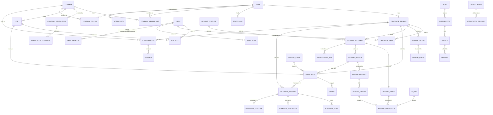

Supporting sub-diagrams recommended (too many entities for one legible page):
**Taxonomy** (Skill, SkillCategory, SkillAlias, SkillTranslation, SkillRelation,
SkillExternalId, UnresolvedTerm, ImportRun), **Notifications** (OutboxEvent →
OutboxConsumerRun / FanoutJob / NotificationDelivery / WebhookDelivery; User →
Notification / NotificationPreference; EmailMessage / EmailSuppression),
**Analytics** (AnalyticsEvent, JobDailyStat, CompanyDailyStat, FunnelSnapshot,
AICostDaily, SteeringSnapshot), **Files** (Attachment, AttachmentGrant,
AttachmentAccess, ConsumedToken).

---

## 6. Use-case model

### 6.1 Actors

| Actor | Kind | Identified by |
|---|---|---|
| Visitor | human, anonymous | no session |
| Candidate | human | `CandidateProfile` |
| Company Owner | human | `CompanyMembership.role = owner` |
| Company Admin | human | `role = admin` |
| Recruiter | human | `role = recruiter` |
| Hiring Manager | human | `role = hiring_manager` (no preset grants; assignment-scoped) |
| Interviewer | human | `role = interviewer` (no preset grants; interview participation) |
| Viewer | human | `role = viewer` (read any application) |
| Staff (support / moderator / admin / superadmin) | human | `StaffRole.level` |
| System (scheduler / workers) | system | Celery beat, workers, `outbox_worker` |
| AI service | external system | Ollama (local) / OpenRouter (hosted) via runner |
| Email provider, Video provider (JaaS), Virus scanner (ClamAV) | external systems | settings |

### 6.2 Use cases and actor mapping

| ID | Use case | Primary actor | Includes / extends |
|---|---|---|---|
| UC01 | Sign up & confirm email | Visitor | includes *Rate-limit check* |
| UC02 | Sign in (with MFA when required) | Candidate/Employer/Staff | extends: *Enter TOTP code* |
| UC03 | Reset password | any user | includes *Rate-limit check* |
| UC04 | Upload CV | Candidate (or Visitor as guest upload) | includes *Scan file*, *Parse CV* |
| UC05 | Review import proposals | Candidate | — |
| UC06 | Analyse CV | Candidate | includes *Score CV*; extends *AI written review* |
| UC07 | Improve CV — guided | Candidate | includes *Show findings*; extends *Draft from answer* |
| UC08 | Improve CV — assisted | Candidate | includes *Prepare rewordings*, *Apply/Reject changes* |
| UC09 | Choose/preview template, export PDF/DOCX | Candidate | extends *Upgrade to Pro* (Pro templates, downloads) |
| UC10 | Browse/search jobs, save, alerts | Visitor/Candidate | — |
| UC11 | See matched jobs | Candidate | includes *Score match* |
| UC12 | Apply to job | Candidate | includes *Freeze CV version*; extends *Cover letter draft (AI)* |
| UC13 | Follow company | Candidate | — |
| UC14 | Practice interview (text/voice) | Candidate | includes *Serve question*, *Submit answer*, *Score interview*; extends *Transcribe answer* |
| UC15 | Book & join live interview | Candidate | — |
| UC16 | Create company | Employer user | — |
| UC17 | Submit verification | Owner/Admin | — |
| UC18 | Invite/manage team | Owner/Admin | — |
| UC19 | Post job | Owner/Admin/Recruiter (`job.publish`) | includes *Resolve skills* |
| UC20 | Review applicants, move stages | Owner/Admin/Recruiter (+Viewer read) | — |
| UC21 | Send offer | Owner/Admin (`offer.send`) | — |
| UC22 | Schedule interviews, score live interview | Owner/Admin/Recruiter/Interviewer | — |
| UC23 | Talent search & pools | Owner/Admin/Recruiter (`candidate.search`) | — |
| UC24 | Manage billing | Owner (`billing.manage`) | — |
| UC25 | Moderate verification | Staff (moderator+) | — |
| UC26 | Operations & anomalies | Staff (support+) | — |
| UC27 | Send notifications | System | includes *Resolve audience*, *Apply preferences* |
| UC28 | Recover stalled work | System | — |
| UC29 | Manage plan (candidate) | Candidate | — |
| UC30 | Export data / erase account | Candidate | — |

### 6.3 Mermaid (flowchart used as a use-case diagram; Mermaid has no native UML use-case notation)

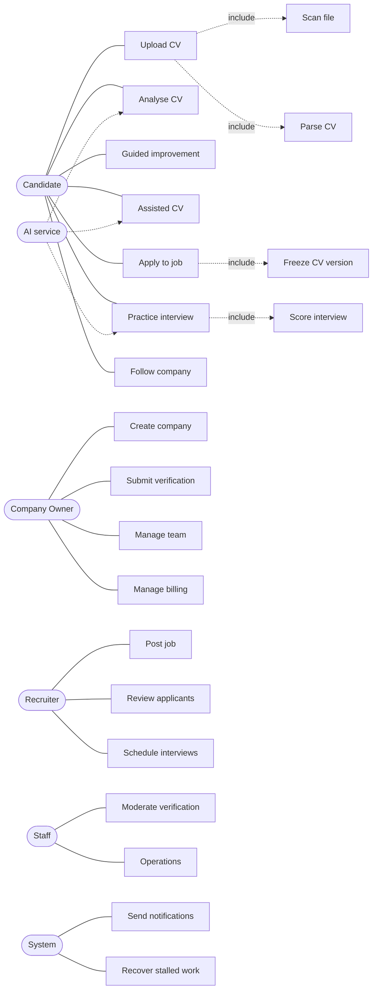

---

## 7. System flowcharts

Each flow below is the implemented path. Mermaid is given for the major ones.

### F1 Registration / sign-in
START → submit form → form valid? (No → show errors, 400, limit **not** consumed) →
signup-per-IP limit (5/h) ok? (No → 429 restriction) → address already registered?
(Yes → email the owner "you already have an account"; same on-screen answer) (No →
create User + unverified primary EmailAddress + consents → email verification link) →
"check your email" page → END.
Sign-in: credentials + per-identity (5/15 min) and per-IP (20/15 min) limits →
valid? (No → error) → MFA required and device present? (Yes → code challenge
`accounts:mfa_challenge`) → session created (`UserSession`) → redirect to home for role → END.
Rate limiter **fails closed**: if Redis is unreachable the action is refused
("This action is temporarily unavailable").

### F2–F4 CV upload → scanning → parsing

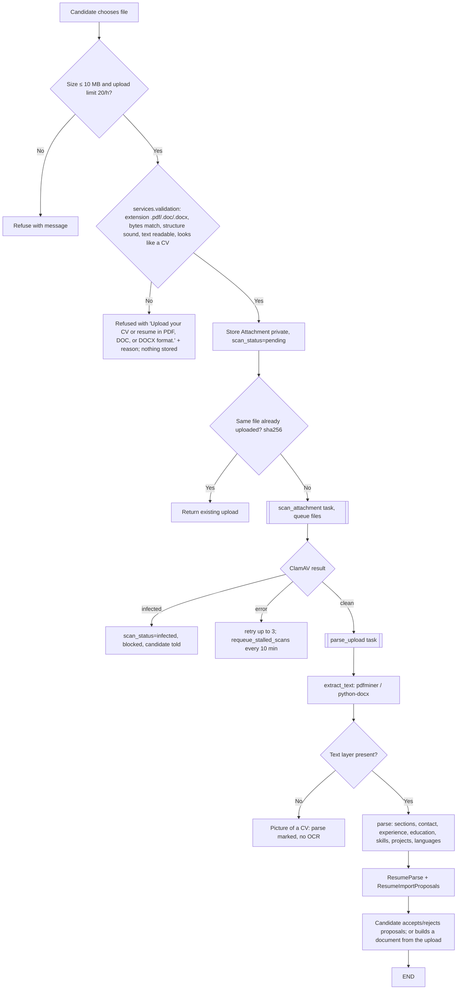

States: `ResumeUpload.parse_status` blocked → pending → running → parsed | failed |
unsupported. Stalled reads (>15 min) are re-queued by `recover_stalled_resume_work`.

### F5 CV analysis
START → candidate picks CV (+ optional role / CareerAI job / pasted advert) →
free plan analyses left? (No → restriction with upgrade) → freeze draft into a
`ResumeVersion` (reuse if unchanged) → deterministic: ATS checks → score (4
components) → findings → target coverage (if a target) → save `ResumeAnalysis`
(enrichment = pending if AI enabled) → show report immediately → [async
`enrich_analysis`: AI verdict + judgement findings, quotes verified] → report
refreshes when ready → END.

### F6–F7 CV → job recommendation and matching

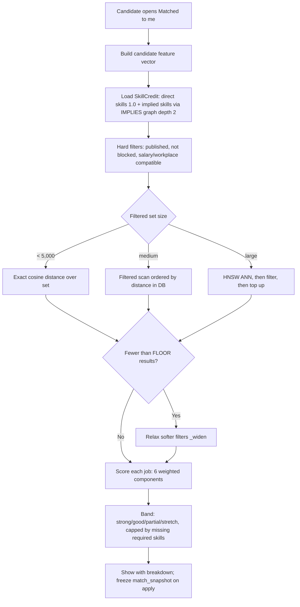

### F8 Application submission
START → job open? → candidate blocked the company? → already a live application? →
cooldown elapsed? → screening answers valid? → letter choice valid? → daily limit
(50/day) → render the chosen CV version (PDF, content-hashed) → transaction:
Application (+ job_snapshot, match_snapshot, render SHA-256, stage "new") +
ApplicationEvent + optional CoverLetter → outbox event → END. Any "No" raises a
`DomainError` shown as a restriction; guards run **before** the limit is consumed.

### F9 Assisted CV improvement

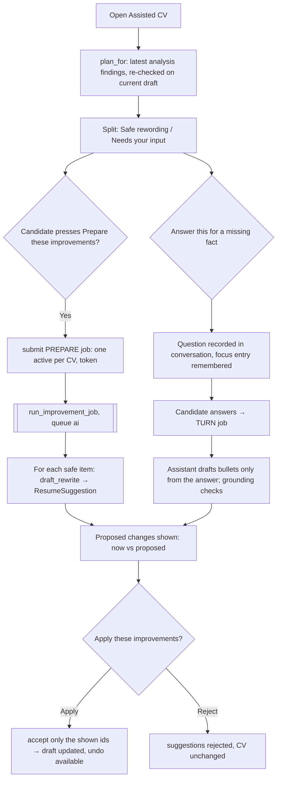

### F10 Guided CV improvement
START → "What we found" (plan items with detected / why / where / what to add) →
item kind? → *contact missing* → type value → written only if field empty →
*needs input* → answer → TURN job focused on the entry → suggestion → accept in
Suggestions → *safe rewording* → draft a rewording (PREPARE job for that item) →
*fix in place* → jump to the field → plan re-checks after every change
(`cv:changed`) → item shows "Looks fixed" → END.

### F11 Target-job gap analysis
START → analysis with a CareerAI job or pasted advert → advert skills extracted
deterministically by the taxonomy → coverage: matched / missing / keyword gaps →
readiness "target" requirement (required skills present?) → "Work on the gaps"
→ `AssistantTargetView` sets the assistant's gap list → assistant asks about each
gap and drafts only from answers → END.

### F12–F17 Interview (creation, practice, questions, answers, scoring, completion)

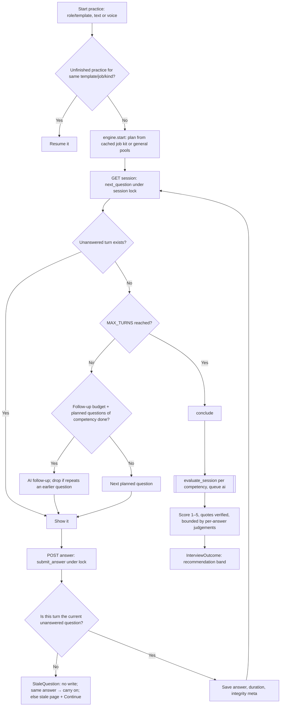

### F18 Browser Back / stale question
START → Back pressed → page is `no-store` → browser re-requests → server returns
the **current** question. If the browser restored a cached page anyway →
`pageshow(persisted)` reloads it. If an old form is still submitted → server
check fails → nothing written → "That question has already been answered" +
Continue → END. (Details §18.)

### F19–F20 Company follow → new-job notification
START → candidate follows company (unique follow) → employer publishes a job →
`job.published` emitted in the same transaction (dedupe key per job) → outbox
drained → audience `company_followers` = active users following **since before
the event** minus those whose profile blocked the company → preference group
"company_updates" applied per recipient → `Notification` (dedupe while unread) +
optional email → END.

### F21 Employer job creation
START → member has `job.publish` (or assignment for edit)? → form + skills
(resolved through the taxonomy; unknown terms queued as `UnresolvedTerm`) →
screening questions → draft saved → publish? (checks: published_at set,
salary ordered, remote scope, external URL) → published → `job.published` →
embedding queued (`embed_job`) → END.

### F22 Company verification
START → Owner/Admin uploads required documents (`registration`, `pan_vat`) →
submission complete? (No → checklist says what is missing) → submit → state
pending → staff claims (conflict-of-interest refused) → decision: verified /
more_info / rejected (with reason; re-apply opens after a wait) → decision
history + notification → END.

### F23 Employer invitation
START → `team.invite` grant → invite (hashed token; one open per email) → email →
invitee signs in/up → accept (hashed token looked up and the invite row locked, so
two tabs or a racing revoke cannot both win; already a member → Conflict) →
membership created with the invited role → invite marked accepted → END. Revoke closes it; ownership transfer is a
separate nominate → accept flow (one pending per company).

### F24 Authorization (company surfaces)
Request → `CompanyContextMiddleware` resolves company from slug and the user's
active membership → no membership → 404 → grant required? (`permissions.require`)
→ missing → `NotAllowed` restriction → assignment scoping (recruiter/hiring
manager see assigned jobs when `strict_assignment_scoping`) → allowed.

### F25 File access
Request with token → signature valid & not expired (5 min)? → token unused?
(single-use ledger `ConsumedToken`) → policy allows **this** actor now? → scan
status clean? → serve bytes + `AttachmentAccess` record → otherwise 404/403.

### F26 Plan restriction
Action → `entitlements.require(owner, key)` → allowed? (No → `PlanLimitExceeded`
→ restriction "Not included in your plan" with Upgrade + View plans) → metered?
→ `claim/consume` usage counter → proceed.

### F27 Billing lifecycle
Free → "Move to Pro" → `subscriptions.subscribe` (new period today) → invoice
issued → paid? (manual payment record) → nightly `chase_overdue` → past_due →
`end_unpaid` after grace → back to Free. Pro → Free: `pending_plan` set, switch at
period end (`renew_due`). Cancel: `cancel_at` = period end → `end_cancelled`.

### F28 Password reset
Request (per-identity 3/h, per-IP 10/h) → same answer whether or not the address
exists → token email → token valid and unused → new password → other sessions
revoked → END.

### F29 MFA
Owners/Admins/Staff: 14-day grace from the grant → after grace, protected
surfaces redirect to MFA setup → TOTP device confirmed → recovery codes → each
session must pass the code challenge once.

### F30 Session revocation
Settings → Security lists `UserSession` rows → "sign out this device" → session
key deleted server-side → row ended. (IDOR sweep: a foreign session id is
refused without writing.)

### F31 Staff moderation
Staff level ≥ required? (no role → 404; lower level → NotAllowed) → queue →
claim → review documents (signed access) → decide → audit log → notify company.

### F32 Demo ad display
Page asks slot → slot in {jobs, dashboard, analysis}? → feature `demo_ads` on? →
first active ad for slot not hidden in this session → render labelled block → END.

---

## 8. Data flow diagrams

### 8.1 Context (Level 0)

External entities: **Candidate**, **Employer member**, **Staff**, **AI provider**
(Ollama/OpenRouter), **Email provider**, **Video provider (JaaS)**, **Virus scanner
(ClamAV)**, **Speech model (local faster-whisper)**.
Single process: **CareerAI platform**.

| Flow | Direction | Data |
|---|---|---|
| Candidate → CareerAI | in | registration, CV files, CV edits, answers, applications, interview answers/audio |
| CareerAI → Candidate | out | analyses, suggestions, matches, notifications, interview results, invoices |
| Employer → CareerAI | in | company data, verification documents, jobs, decisions, scorecards, offers |
| CareerAI → Employer | out | applicants (with frozen CV), match snapshots, AI evaluations (labelled), analytics |
| Staff ↔ CareerAI | both | verification decisions, moderation, operations data |
| CareerAI ↔ AI provider | both | prompts with fenced candidate data → JSON outputs |
| CareerAI → Email provider | out | verification, reset, notifications, digests |
| CareerAI ↔ JaaS | both | signed room tokens / room joins |
| CareerAI ↔ ClamAV | both | file bytes → scan verdict |

### 8.2 Level 1 processes and data stores

Processes: P1 Authentication & accounts · P2 CV intake (upload, scan, parse) ·
P3 CV building & improvement · P4 CV analysis · P5 Job management · P6 Matching ·
P7 Applications & pipeline · P8 Interviews · P9 Messaging · P10 Notifications ·
P11 Billing · P12 Company & verification · P13 AI runner · P14 Staff operations.

Data stores (real tables): D1 Users & sessions (User, EmailAddress, UserSession,
Consent) · D2 Candidate profiles (CandidateProfile + Profile* + CandidateSkill) ·
D3 Files (Attachment, grants, access) · D4 CV documents (ResumeUpload, Parse,
Document, Draft, Version, Suggestion, ImprovementJob) · D5 Analyses (ResumeAnalysis,
Finding, AtsCheck) · D6 Taxonomy (Skill, Alias, Relation, …) · D7 Jobs (Job,
JobSkill, …) · D8 Applications (Application, events, notes, offers) · D9
Interviews (Session, Turn, Evaluation, Outcome, slots) · D10 Companies (Company,
Membership, Verification, Follow) · D11 Notifications (Outbox, Notification,
Delivery, Email) · D12 Billing (Plan, Subscription, Invoice, Payment, Usage) · D13
AI runs & prompts (AIRun, PromptTemplate, Quota) · D14 Audit & analytics.

| From | To | Data |
|---|---|---|
| Candidate | P2 | CV file |
| P2 | D3, D4 | attachment, upload, parse, proposals |
| P2 ↔ ClamAV | | bytes / verdict |
| P4 | D5 | analysis, findings, checks |
| P4, P3, P8 | P13 | AI task inputs |
| P13 ↔ AI provider | | fenced prompt / JSON |
| P13 | D13 | AIRun |
| P6 | D2, D7, D6 | read features, skills, implication graph |
| P7 | D8 | application + snapshots |
| P5, P7, P8, P12 | D11 | outbox events |
| P10 | Candidate/Employer, Email provider | notifications |
| P11 | D12 | subscriptions, invoices |
| P12 | D10 | companies, memberships, verification |
| P14 | D10, D1, D14 | decisions, audit |

### 8.3 Level 2 — CV processing (P2 + P4 + P3)

2.1 Validate & sniff → 2.2 Store attachment (D3) → 2.3 Scan (ClamAV) → 2.4
Extract text → 2.5 Parse → 2.6 Propose imports (D4) → 4.1 Freeze version (D4) →
4.2 ATS checks → 4.3 Score → 4.4 Findings → 4.5 Target coverage (D6) → 4.6 Save
analysis (D5) → 4.7 AI enrichment (P13) → 3.1 Build plan (D5 + live check) → 3.2
Improvement job (D4) → 3.3 Draft suggestions (P13) → 3.4 Accept/Reject → D4 draft.

### 8.4 Level 2 — Interview (P8)

8.1 Plan kit (job → P13 `interview.plan`, cached per job) → 8.2 Start session (D9)
→ 8.3 Serve question (lock D9) → 8.4 Receive answer (lock, current-turn check) →
8.5 [voice] Transcribe (faster-whisper; audio deleted) → 8.6 Follow-up (P13
`interview.followup`) → 8.7 Conclude (lock) → 8.8 Evaluate per competency (P13
`interview.evaluate`, verification) → 8.9 Outcome (D9) → 8.10 Notify (D11).

---

## 9. UML activity diagram specifications

**A1 CV processing.** Initial → *Upload* → decision valid? → *Store* → fork:
[*Scan*] → decision clean? → *Parse* → *Create proposals* → join → *Review
proposals* (loop per proposal: accept/reject) → final. Termination: parsed,
unsupported, infected or failed.

**A2 CV improvement.** Initial → *Open plan* → loop over items { decision kind →
*Answer* | *Draft rewording* | *Fill contact* | *Edit field* } → *Review
suggestions* → decision apply? → *Accept* (undoable) / *Reject* → *Plan re-check*
→ loop until all addressed or the candidate leaves → final.

**A3 Job application.** Initial → *Open job* → *Choose CV version* → *Answer
screening questions* → *Optional cover letter (AI draft allowed)* → guards (open,
not blocked, no live application, cooldown, answers, daily limit) → *Render CV* →
*Record application* → *Emit event* → final.

**A4 Interview.** Initial → *Start/resume session* → loop { *Serve current
question* → *Answer* (text, or record → transcribe → edit) → decision stale? →
*Stale page* → *Continue* } until no question left or *Finish early* → *Conclude* →
async *Evaluate* → *Outcome* → final. Parallel: follow-up generation happens inside
*Serve*; evaluation runs on the ai queue while the result page polls.

**A5 Interview answer submission.** Initial → *Lock session row* → *Lock turn
row* → decision finished? → decision answered? → decision current? → *Write
answer* → *Commit* → *Redirect to session*; any failing decision → *No write* →
decision same answer? → *Redirect* / *Stale page*.

**A6 Employer hiring.** Initial → *Post job* → *Receive applications* → loop {
*Review* → *Move stage* (notes, tags, ratings) } → decision interview? → *Schedule*
→ *Score (live or AI)* → decision offer? → *Send offer* → decision accepted? →
*Hired* / *Not proceeding* → final.

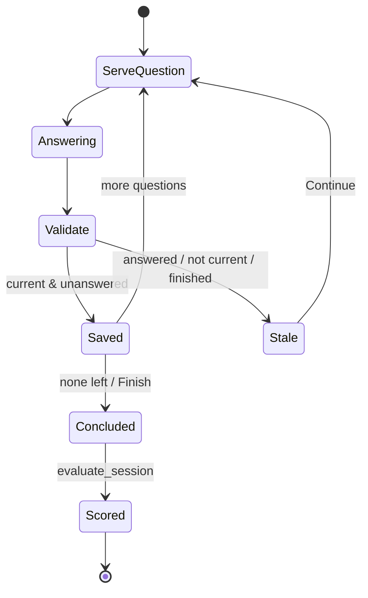

---

## 10. UML sequence diagrams

### A. CV upload

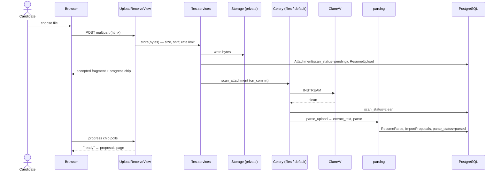

### B. AI-assisted CV improvement

```mermaid
sequenceDiagram
    actor C as Candidate
    participant B as Browser
    participant V as BuilderCommandView
    participant J as improvements.submit
    participant DB as PostgreSQL
    participant W as Celery (ai)
    participant R as ai.runner
    participant M as Model (Ollama)
    C->>B: Prepare these improvements
    B->>V: POST improve_prepare (token)
    V->>J: submit(kind=prepare)
    J->>DB: lock document; active job? token used?
    J->>DB: ImprovementJob(queued); pointer on document
    V-->>B: editor region + HX-Trigger improve:queued
    B->>V: GET job panel (polls every 2 s)
    J->>W: run_improvement_job (on_commit)
    W->>DB: state=processing, stage=checking
    loop each safe rewording
        W->>R: run(resume.bullet_rewrite / resume.summary)
        R->>M: fenced prompt
        M-->>R: JSON options
        R-->>W: validated output
        W->>DB: ResumeSuggestion(offered)
    end
    W->>DB: state=completed
    B->>V: GET job (watching) → HX-Trigger improve:done
    B->>V: redraw plan / editor
    C->>B: Apply these improvements
    B->>V: POST improve_apply ids=[shown]
    V->>DB: accept each → draft updated (snapshot for undo)
```

### C. Interview question answering (with stale case)

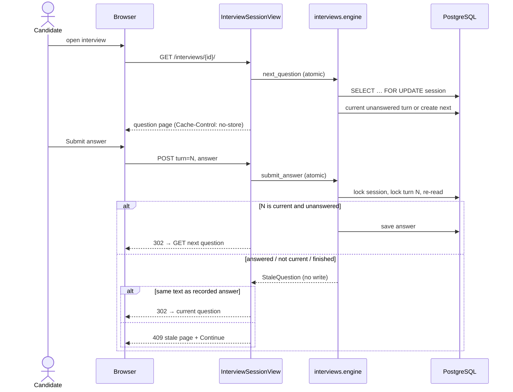

### D. Interview scoring

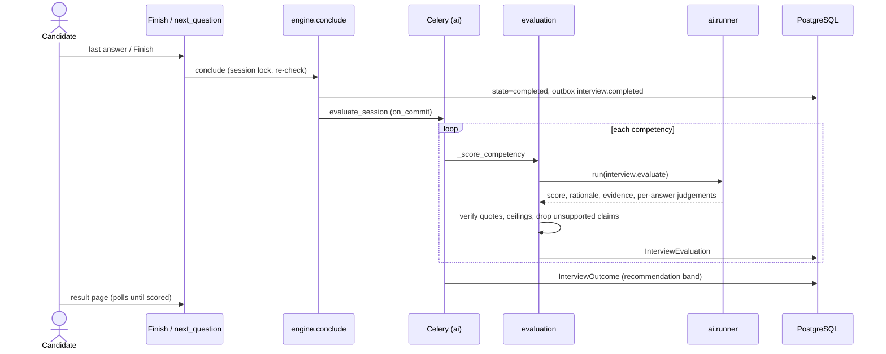

### E. Company follow → new-job notification

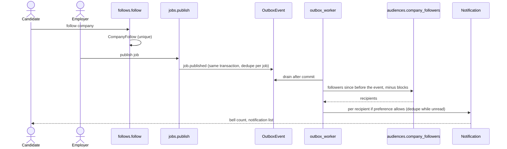

### F. Sign-in with MFA

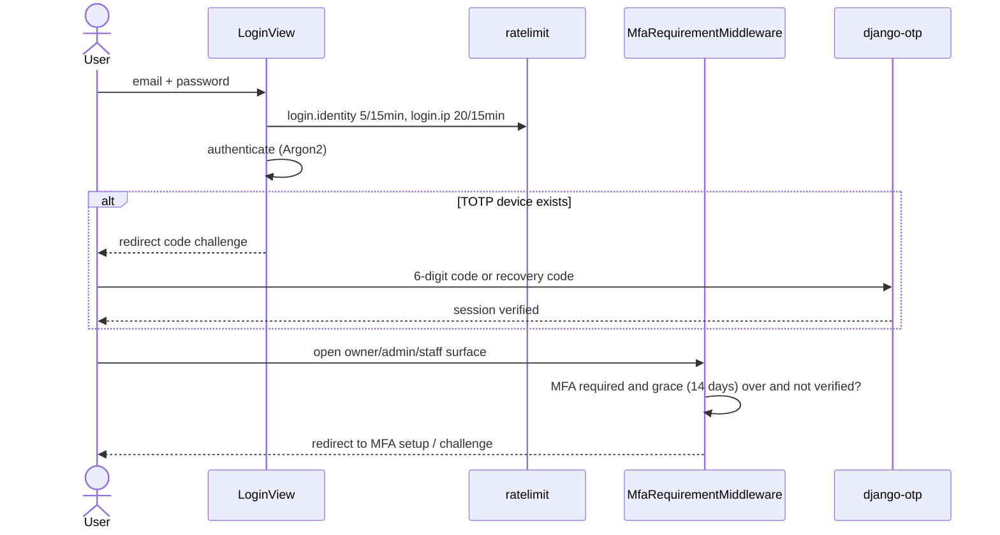


---

## 11. Algorithms

41 algorithms are documented below. Complexity is given where it follows directly
from the code; *n* is the number of items processed.

### ALG-01 File type sniffing
- **Purpose:** trust bytes, not the browser's content type or file extension.
- **Input → Output:** first bytes of an upload → one of PDF / DOCX / DOC / PNG / JPEG, or refusal.
  `classify()` additionally names a refused format (image, archive, program,
  HTML, XML, CSV, spreadsheet, presentation, RTF, text, OpenDocument,
  macro-enabled or template Word file) for the refusal message.
- **Steps:** check the magic numbers `%PDF-`, `PK\x03\x04`, `\x89PNG…`, `\xff\xd8\xff`.
  A ZIP is DOCX only if the container holds the Word parts; any other ZIP (JAR,
  XLSX, ODT, renamed archive) is refused here rather than inside a parser.
- **Failure:** `UnsupportedFileType`. **Complexity:** O(1) plus a ZIP directory read.
- **Source:** `apps/files/sniff.py`. **Tests:** `apps/files/tests`.

### ALG-02 Malware scan (clamd INSTREAM)
- **Steps:** send `zINSTREAM\0`, then length-prefixed chunks, then a zero-length
  chunk; read the verdict. The state moves pending → clean | infected | error.
- **Retry:** `scan_attachment` max_retries=3 with `acks_late`; stalled scans are
  re-queued every 10 min (`requeue_stalled_scans`).
- **Fallback:** `AllowAllScanner` in dev/tests. A system check refuses it when DEBUG is off.
- **Source:** `apps/files/scanning.py::ClamAVScanner`, `apps/files/tasks.py`.

### ALG-03 Text extraction
- **Steps:** pdfminer.six for PDF; python-docx for DOCX (paragraphs and tables,
  read row-major); for Word 97-2003 `.doc`, a pure-Python OLE2 reader
  (`apps/files/ole.py`) and the piece table (`parsing/doc.py`), main document
  only, fields reduced to their results, encrypted files refused. Engine `deterministic`, `ENGINE_VERSION = "1.4"`.
- **Picture detection:** `_looks_like_a_picture` flags an image-only PDF (no text
  layer), which yields "picture of a CV".
- **OCR:** NOT IMPLEMENTED, by decision (ledger §15/§18).
- **Source:** `apps/resumes/parsing/text.py`, `base.py`.

### ALG-04 Deterministic CV parsing
- **Input → Output:** text → `ParsedResume` (name, headline, emails, phones,
  location, links, skills, experience, education, projects, certifications,
  languages, per-field confidence, warnings).
- **Steps:**
  1. Split lines.
  2. Detect headings (`_heading_key`, plus unknown headings kept as their own section).
  3. Split into sections.
  4. Extract contact details: email regex, phone numbers (`_phones`), links.
  5. Pick name and headline from the top lines, rejecting lines that read like
     a role or are not name-shaped (`_looks_like_a_name`, `_reads_like_a_role`).
  6. Experience: join wrapped date lines, find date ranges, split title/org,
     attach bullets (continuation rules).
  7. Education; skills split on separators **outside brackets**, so
     "Python (Django, Flask)" stays one term; projects; languages.
  8. Compute confidence per field.
- **Complexity:** O(n) in lines.
- **Failure:** `ExtractionFailed`, `UnsupportedFormat`.
- **Source:** `apps/resumes/parsing/extract.py::parse`.
- **Tests:** `apps/resumes/tests/test_parsing.py`, benchmark corpus (`test_extraction_benchmark.py`).

### ALG-05 Text normalisation for matching
- **Steps:** NFKC normalise, casefold; keep significant symbols (e.g. `+`, `#` in
  C++/C#); map punctuation, symbols, control and space categories to a space;
  collapse whitespace.
- **Purpose:** the same key for "ＪＳ"/"JS", and composed/decomposed Devanagari.
- **Source:** `apps/taxonomy/normalisation.py::normalise`.

### ALG-06 Layered skill resolution
- **Order (strongest first):**
  1. exact alias on the normalised form;
  2. exact canonical name (case-folded);
  3. exact translation (non-English input);
  4. trigram similarity ≥ **0.55**.
- **Forwarding:** a retired skill resolves to its replacement (`_forward`).
- **Batch version:** `resolve_many` runs each layer once for the whole list (a
  fixed number of queries, whatever the list length).
- **Decision rule:** an exact layer always beats fuzzy. The threshold stops "java"
  reaching "javascript" (~0.36).
- **Unresolved terms** are recorded in `UnresolvedTerm` for curation (`taxonomy/services/terms.py`).
- **Source:** `apps/taxonomy/services/skills.py`.

### ALG-07 Skill-graph traversal
- **Steps:** breadth-first walk over `SkillRelation` edges of one kind (`implies`,
  `broader`, `narrower`), keeping a `seen` set. For `implies` the carried weight
  is multiplied by each edge weight; the best value per target is kept.
- **Bounds:** `MAX_DEPTH = 4`, so the walk terminates even if curation creates a cycle.
- **Complexity:** O(V + E) within the depth bound.
- **Source:** `skills.py::_walk`, `implications`, `ancestors`, `descendants`.

### ALG-08 Skill credit
- **Input:** a candidate's `CandidateSkill` rows (at most 200).
- **Output:** `SkillCredit(direct = {id: 1.0}, implied = {id: best weight})`.
- **Steps:** implications per skill, walked to depth `IMPLICATION_DEPTH = 2`; an
  implied skill never overrides a direct one.
- **Source:** `apps/matching/extract.py::skill_credit_for`.

### ALG-09 Retrieval strategy selection
- **Hard filters:** published, not blocked, salary-compatible, workplace-compatible.
- **Strategy by filtered-set size:**
  - `< SMALL_SET (5,000)` → exact cosine over the set;
  - medium → filtered scan ordered by distance in the database;
  - large → HNSW approximate search, then filter, then top up.
- **Thin-result rule:** if fewer than `FLOOR` results remain, softer filters are
  relaxed (`_widen`) rather than showing an empty feed.
- **Source:** `apps/matching/retrieval.py`.

### ALG-10 Match score (ALGORITHM_VERSION 2)
- **Weights:** skills 50, experience 20, domain 10, location 8, salary 7,
  recency 5 (sum 100, asserted by tests).
- **Skills:**
  - importance = job skill weight, ×2.0 if required;
  - credit ≥ 1.0 → matched (and adjusted for years);
  - credit ≥ 0.35 → partial;
  - otherwise missing (credit 0);
  - share = Σ importance·credit / Σ importance.
  - A posting with no skills listed scores a neutral 0.6.
- **Experience:** ratio = candidate months / band months. At or above 1, points =
  w·(1 − 0.25·min((ratio−1)/3, 1)); below 1, points = w·ratio. No requirement
  stated → 0.8.
- **Domain:** same industry → full; different → 0.4; unknown → 0.6.
- **Location:**
  - remote and the candidate is willing → full;
  - remote but not wanted → 0.5;
  - same city → full;
  - candidate location unknown → 0.6;
  - hybrid and other cases → see `_location`.
- **Salary:** the job's ceiling meets the candidate's minimum → full; else
  w·(1 − shortfall); unknown → 0.6.
- **Recency:** w·(0.7·freshness + 0.3·liveness), from posting age and the
  candidate's last activity.
- **Year adjustment:** matched credit × max(0.5, held/asked years) when the
  candidate has fewer years than asked.
- **Output:** 0–100 (clamped), components with notes, and matched/partial/missing ids.
- **Complexity:** O(k) per pair (k = job skills).
- **Source:** `apps/matching/scoring.py::score`. **Tests:** `apps/matching/tests` (golden cases).

### ALG-11 Match band with requirement cap
- **Bands:** ≥ 85 strong, ≥ 70 good, ≥ 50 partial, else stretch.
- **Cap:** if any required skill is missing, the band is at best "good"; if half or
  more are missing, at best "partial". The number itself is not changed.
- **Source:** `band_for`.

### ALG-12 ATS checks
Eight deterministic checks, each pass / warn / fail with a note:
`extraction`, `contact`, `headings`, `dates`, `length`, `outcomes` (target: 35% of
bullets measured), `bullet_style`, `filename`.
Source: `apps/resumes/analysis/checks.py`.

### ALG-13 CV score (ALGORITHM_VERSION 1)
- **Components:** machine readability 25 (critical checks: extraction, contact),
  evidence and impact 30, skills coverage 20, structure and length 25.
- **Output:** 0–100 plus a breakdown with a note per component.
- **Source:** `apps/resumes/analysis/scoring.py`.

### ALG-14 Deterministic findings
Codes, each raised only when the condition holds on the page:

| Group | Codes |
|---|---|
| Contact | `contact_incomplete` |
| Summary | `no_summary`, `thin_summary` (< 15 words), `generic_summary` (≥ 2 stock phrases) |
| Bullets | `duty_language`, `no_outcomes` |
| Structure | `thin_entry` (role with no description), `untitled_role`, `thin_project`, `no_education` |
| Skills | `no_skills`, `unevidenced_skills` |
| History | `unreadable_dates`, `employment_gap` (top 2), `no_experience` / `no_paid_experience` |
| Strengths | `measured_writing`, `rising_titles`, `evidenced_skills` |

Findings are ordered critical → improve → strength. Each carries `section_ref`
in the suggestion-path vocabulary.
Source: `apps/resumes/analysis/findings.py::deterministic_findings`.

### ALG-15 Target coverage
Skills named in a CareerAI job (required/preferred) or a pasted advert
(taxonomy-extracted; all treated as required) are compared with the CV text →
matched, missing, and keyword gaps. Deterministic.
Source: `apps/resumes/analysis/target.py`.

### ALG-16 Readiness verdict
- **Complete only if all applicable requirements are met:**
  - *sections*: the guided steps, where an honestly set-aside step does not count against;
  - *ats*: the latest analysis of **this exact content** has no failing check;
  - *target*: every required advert skill appears in the CV, when a target exists.
- A requirement that does not apply is omitted, not marked met.
- **Source:** `apps/resumes/readiness.py::assess`.

### ALG-17 Improvement plan construction
- **Input:** the latest analysis findings (one query, via a sub-select for the
  newest analysis) or, with no analysis, live deterministic findings.
- **Steps:**
  1. Map each non-strength finding to a `PlanItem`: detected text, why, where
     (section/entry resolved to names and an editor anchor), asks, and kind
     from `GUIDANCE` — `reword`, `needs_input` or `edit`; an unknown code
     defaults to `needs_input`.
  2. Re-run the deterministic rules on the current draft. A finding no longer
     present is marked `addressed`; a summary finding stays open while any
     summary finding remains.
  3. Attach pending suggestions for the finding or its entry → `drafted`.
  4. Sort open items before addressed ones, then critical before improve.
- **Source:** `apps/resumes/improvement.py::plan_for`.

### ALG-18 Idempotent background job submission
See §12 pseudocode. Source: `apps/resumes/services/improvements.py::submit`, `run`, `retry`.

### ALG-19 Evidence-first assistant questioning
Before drafting from a claim ("I know Python"), the assistant asks where, then
what, then the result — each at most once. A declined skill ("No, I haven't used
X") moves on to the next gap without a model call.
Source: `apps/resumes/services/evidence.py::next_step`, `gap_question`, `cv_gap_question`.

### ALG-20 Assistant grounding filters
A proposed bullet or role field is dropped if it:
- is addressed to the candidate (second person);
- is not grounded in what the candidate said (`_is_grounded_in`: content words
  and figures must come from their words; share ≥ 0.4, at least 3 words);
- repeats a figure or action the candidate took back;
- talks about the conversation itself;
- is a placeholder ("Company Name", "N/A");
- duplicates something already shown (fingerprint).

Messages that are instructions to the assistant ("ignore previous instructions…")
or that disown their own claim are answered without a model call.
Source: `apps/resumes/services/assistant.py`.

### ALG-21 Interview question relevance
- **Scoring:** questions are scored against the posting using content stems,
  borrowed phrases and (when available) embedding cosine similarity
  (`SEMANTIC_THRESHOLD = 0.75`).
- **Serving:** `choose_served` keeps a minimum pool of `MIN_POOL = 3` per competency.
- **Source:** `apps/interviews/services/relevance.py`.

### ALG-22 Question serving order
- **Order:**
  1. an existing unanswered turn (a refresh never skips a question);
  2. if `MAX_TURNS = 24` has been reached → finish;
  3. a follow-up, but only after the competency's planned questions are done,
     within `MAX_FOLLOWUPS_PER_COMPETENCY = 2`, and not a repeat;
  4. the next planned question.
- **Source:** `apps/interviews/services/engine.py::next_question`.

### ALG-23 Follow-up repetition check
A follow-up that shares ≥ 45% of significant words (`SAME_QUESTION_SHARE = 0.45`)
with an earlier question is dropped, and the next planned question is used instead.
Source: `engine._already_asked`.

### ALG-24 Stale-question protection (replay / Back / multi-tab)
See §12 and §18. Source: `engine._locked`, `_require_current`, `current_turn`,
`StaleQuestion`; `portals/candidate/interview_views.py::_stale_answer`.

### ALG-25 Interview scoring pipeline
Per competency:
1. No substantive answer (non-answers, fewer than 6 words) → score 1, no model call.
2. Call `interview.evaluate`.
3. On a schema error, ask once more.
4. If the output quotes words not found in the answers, ask once more; any
   quote still not found is replaced with "[not found in the answers]".
5. A grounded factual error caps the score at `WRONG_CLAIM_CEILING = 2`.
6. Per-answer judgements bound the score: all off-topic → 1; no answer fully
   on-topic → cap `PARTIAL_CEILING = 3`.
7. Rationale sentences not supported by the answers are dropped.
8. Evidence not found in the answers is cleared.
9. Integrity metrics are never sent to the model.

Source: `apps/interviews/services/evaluation.py`.

### ALG-26 Recommendation bands
- **Bands:** average ≥ 4.3 strong yes; ≥ 3.4 yes; ≥ 2.2 no; otherwise strong no.
- For practice interviews the UI shows the weakest and strongest competency
  instead of a hire verdict.
- **Source:** `engine.recommend`, `interview_views._practice_verdict`.

### ALG-27 Notification audience resolution
- Each event type registers an audience name (14 registered, e.g.
  `company_followers`, `application_company_team`, `saved_job_holders`).
- The resolver returns the recipients; the channel layer then applies
  preferences and mutes; `Notification.dedupe_key` stops a repeat while unread.
- **`company_followers`:** active users who followed **before the event was
  created**, minus users whose profile blocked the company.
- **Source:** `apps/notifications/services/audiences.py`, `events.py`.

### ALG-28 Transactional outbox and fan-out
- `emit()` writes an `OutboxEvent` in the caller's transaction.
- `outbox_worker` drains events after commit; consumers run once each
  (unique on event + consumer).
- Large audiences are chunked into `FanoutJob`s (`run_fanout` every minute).
- `NotificationDelivery` is unique per (event, recipient, channel).
- **Source:** `apps/notifications`.

### ALG-29 Company permission check
Effective grants = the role preset ∪ validated extra grants; an inactive
membership has none; `require()` rejects unknown keys. See §20.
Source: `apps/companies/permissions.py`.

### ALG-30 Staff level check
Ordered levels support < moderator < admin < superadmin; the check is
`at_least(level)`. No role → 404; too junior → NotAllowed.
Source: `apps/accounts/staff.py`.

### ALG-31 Private file access
- **Steps:**
  1. Signed token (HMAC via `django.core.signing`) naming file, reader and
     purpose, valid 5 minutes (`FILES_SIGNED_URL_MAX_AGE = 300`).
  2. Single use, enforced by the `ConsumedToken` ledger (unique jti + purpose).
     It fails closed if the database is unavailable.
  3. The policy re-checks the actor's permission now.
  4. The attachment must be scan-clean.
  5. The access is logged in `AttachmentAccess`.
- **Source:** `apps/files/signing.py`, `policies.py`, `views.py`.

### ALG-32 Entitlements and metering
- The plan's `limits` document is read per owner.
- `allows` / `require` handle boolean and valued limits.
- `claim` / `consume` / `release` meter usage in `UsageCounter` per period.
- `PlanLimitExceeded` is shown as an upgrade restriction.
- **Source:** `apps/billing/services/entitlements.py`.

### ALG-33 Billing transitions (nightly)
- `renew_due`: roll periods forward and raise invoices; apply pending plan changes at the period end.
- `chase_overdue`: move to past_due when an invoice is overdue.
- `end_unpaid`: withdraw after the grace period.
- `end_cancelled`: end at `cancel_at`.
- Upgrades to Pro start immediately on a new period, with a whole-period invoice.
  No proration. An overdue invoice blocks paid plans.
- **Source:** `apps/billing/services/subscriptions.py`, `tasks.py`.

### ALG-34 Rate limiting
- **Method:** fixed-window counters in Redis. Key = `rl:{rule}:{sha256(identifier)[:32]}:{window bucket}`,
  so no personal data appears in keys. `add` + `incr`; over the limit →
  `RateLimited`.
- **Failure:** fails closed by default (the cache raises → action refused);
  `fail_closed=False` for webhook and job search.
- **Rules:** 14 (§19).
- **Source:** `apps/common/ratelimit.py`.

### ALG-35 Idempotency keys
- **Scope:** POST endpoints that need replay safety record
  (`key`, `endpoint`) → response reference in `IdempotencyKey`.
- **Behaviour:** a repeat returns the stored outcome (unique per key + endpoint).
- **Source:** `apps/common/idempotency.py`.

### ALG-36 AI run pipeline
Kill switch → quota → cache (task + prompt version + input hash) → dispatch down
the fallback chain (one `AIRun` per attempt, failures classified) → JSON-schema
validation → record cost/latency/lineage. See §15.
Source: `apps/ai/services/runner.py`.

### ALG-37 Prompt versioning
Each prompt file is hashed; the version increments only when the body changes;
runs store `prompt_version`.
Source: `apps/ai/services/prompts.py`, `manage.py load_prompts`.

### ALG-38 Stall recovery sweeps
- **Parse:** pending/running for more than 15 min → re-queued.
- **Written review:** pending for more than 30 min → failed, with a free retry offered.
- **Improvement jobs:** active for more than 10 min → failed, with a retry
  offered (also checked on read).
- **Interviews:** unscored interviews are re-queued; stalled scans are re-queued.
- **Source:** `resumes/tasks.py::recover_stalled_resume_work`,
  `interviews/tasks.py::recover_unscored_sessions`, `files/tasks.py::requeue_stalled_scans`.

### ALG-39 Speech delivery signals
- **Input:** the transcript word timings.
- **Output:** pace, long pauses, filler words.
- The measurements are signed (`delivery.sign`) and only accepted back if the
  seal is valid (`unsign`, max age 1 h). They are feedback only, never scored.
- **Source:** `apps/interviews/services/delivery.py`.

### ALG-40 Salary FX normalisation
Salaries are stored in their own currency and also as `*_base` values, using
the `FxRate` of the day (`fx_rate_id`, value, as_of, source), so comparisons use
one currency.
Source: `apps/taxonomy/services/money.py`, `candidates`/`jobs` models.

### ALG-41 Demo ad slot selection
Slot ∈ {jobs, dashboard, analysis} and the feature `demo_ads` is on → the first
active ad for the slot not hidden in this session.
Source: `apps/core/ads.py::for_slot`.

---

## 12. Pseudocode (actual implementations)

### 12.1 Match score (ALG-10/11)

```
FUNCTION score(candidate_features, job_features, credit):
    components = []
    wanted   = job.job_skill_ids
    required = job.job_required_skill_ids
    IF wanted is empty:
        skills = Component(points = 50 * 0.6, note = "posting lists no skills")
    ELSE:
        earned = possible = 0
        FOR skill IN wanted:
            importance = job.weight[skill] OR 1.0
            IF skill IN required: importance *= 2.0
            possible += importance
            value = credit.direct[skill] ? 1.0 : credit.implied.get(skill, 0)
            IF value >= 1.0:
                matched.add(skill)
                value = year_adjusted(value, cand.years[skill], job.min_years[skill])
            ELSE IF value >= 0.35: partial.add(skill)
            ELSE: missing.add(skill); value = 0
            earned += importance * value
        skills = Component(points = 50 * earned / possible)
    components = [skills, experience(), domain(), location(), salary(), recency()]
    total = clamp(round(sum(points)), 0, 100)
    band  = first band with total >= threshold IN [(85,strong),(70,good),(50,partial),(0,stretch)]
    m = |required ∩ missing|, r = |required|
    IF m > 0: band = worse_of(band, "partial" IF 2m >= r ELSE "good")
    RETURN Match(total, band, components, matched, partial, missing, version=2)
```

### 12.2 Layered skill resolution (ALG-06)

```
FUNCTION resolve_many(texts, locale):
    keys = { t: normalise(t) }
    pending = set(keys.values)
    by_key = {}
    FOR alias IN SkillAlias WHERE normalised IN pending AND locale IN [locale, "en"]:
        by_key[alias.normalised] = forward(alias.skill, 1.00, "alias")   # prefer caller locale
    pending -= by_key
    FOR skill IN Skill WHERE lower(name) IN pending: by_key.setdefault(name, forward(skill, 1.00, "name"))
    pending -= by_key
    IF locale != "en": FOR tr IN SkillTranslation WHERE lower(name) IN pending: ...
    pending -= by_key
    IF pending: by_key += best trigram match per key WHERE similarity >= 0.55
    RETURN { t: by_key.get(keys[t]) }

FUNCTION forward(skill, confidence, method):
    WHILE skill.status != active AND skill.replaced_by: skill = skill.replaced_by
    RETURN Match(skill, confidence, method)
```

### 12.3 Interview answer submission with replay protection (ALG-24)

```
FUNCTION submit_answer(session, turn, text, ...):            # @transaction.atomic
    answer = trim(text)
    SELECT id FROM session WHERE id = session.id FOR UPDATE; session.refresh()
    IF turn.session_id != session.id: RAISE NotFound
    SELECT id FROM turn WHERE id = turn.id FOR UPDATE; turn.refresh()
    IF session.is_finished:           RAISE StaleQuestion(finished=True)
    IF turn.answer_text != "":        RAISE StaleQuestion(same_answer = (turn.answer_text == answer))
    current = first turn of session WHERE answer_text = "" ORDER BY order
    IF current.id != turn.id:         RAISE StaleQuestion
    IF answer == "":                  RAISE InvalidState("Write an answer, or skip")
    turn.answer_text, answered_at, duration_ms, integrity_meta, delivery_meta = ...
    SAVE turn
    RETURN turn

VIEW POST /interviews/<id>/:
    TRY submit_answer(...)
    CATCH StaleQuestion e:
        IF e.same_answer AND NOT e.finished: REDIRECT to current question     # double click / retry
        RENDER stale page (409, no-store): "already answered" + Continue / See result
    REDIRECT to /interviews/<id>/                                            # POST-redirect-GET

VIEW GET /interviews/<id>/:
    turn = next_question(session)          # same session lock → one new turn even with two tabs
    RENDER question with Cache-Control: no-store
```

### 12.4 Idempotent improvement job (ALG-18)

```
FUNCTION submit(document, actor, kind, payload, token):     # atomic
    lock document row FOR UPDATE; refresh latest_improvement_job pointer
    IF token AND job with (document, token) exists: RETURN (that job, created=False)
    running = current_for(document)          # fails a job stale > 10 min on read
    IF running is active: RETURN (running, False)
    IF kind == turn:
        IF payload.question: record assistant turn(question)
        record candidate turn(text)          # "received" is true before any model call
    TRY create ImprovementJob(queued, stage=received, token)
    CATCH IntegrityError (partial unique: one active per document): RETURN (active job, False)
    set document.latest_improvement_job = job
    ON COMMIT: run_improvement_job.delay(job.id)
    RETURN (job, True)

FUNCTION run(job_id):
    lock job FOR UPDATE SKIP LOCKED OF (job)
    IF job.state != queued: RETURN "skipped"             # duplicate delivery
    state=processing, stage=checking, attempts += 1
    TRY:
        turn:    stage=drafting/waiting_ai → assistant.respond(already_recorded, focus_entry)
                 IF model unanswered: FAIL("The AI could not be reached…")
                 stage=reviewing → COMPLETE({reply, suggestions})
        prepare: FOR item IN plan.draftable (or requested keys):
                     stage=drafting "i of n: <where>" → draft_rewrite → suggestion
                 IF none drafted: FAIL(...) ELSE COMPLETE({drafted, skipped})
    CATCH any exception: log; FAIL(generic message)       # never the exception text
```

### 12.5 Improvement plan (ALG-17)

```
FUNCTION plan_for(document, analysis=UNSET, offered=None):
    live = deterministic_findings(document.draft.content, ats_checks(...))
    live_keys = {(f.code, f.section_ref)}; live_summary = any(f.section_ref == "summary")
    (analysis, rows) = UNSET ? latest_findings(document) : (analysis, analysis.findings)
    source = analysis ? "analysis" : "live"
    rows = source == "analysis" ? rows WITHOUT strengths : live WITHOUT strengths
    offered = offered OR open suggestions of the draft
    FOR row IN rows:
        item = PlanItem(row, GUIDANCE[row.code] OR needs_input, locate(row.section_ref))
        IF NOT item.from_ai AND (row.code,row.section_ref) NOT IN live_keys
           AND NOT (row.section_ref == "summary" AND live_summary):
            item.status = addressed
        item.suggestions = offered answering this item (finding id, same path, or same entry)
        IF item.status == open AND item.suggestions: item.status = drafted
    SORT items BY (addressed last, critical before improve)
    RETURN Plan(items, source, analysis, strengths)
```

### 12.6 Company-follower audience (ALG-27)

```
FUNCTION company_followers(event):
    RETURN Users WHERE follows(company = event.payload.company_id)
                   AND follow.created_at <= event.created_at
                   AND is_active
           EXCLUDING users whose profile blocked that company
           DISTINCT
    # then, per recipient: preference group "company_updates", mutes, dedupe key per job
```

### 12.7 Rate limit (ALG-34)

```
FUNCTION enforce(rules_with_identifiers):
    FOR (rule, identifier) IN rules:
        key = "rl:" + rule.name + ":" + sha256(identifier)[:32] + ":" + floor(now / rule.window)
        TRY: cache.add(key, 0, timeout = rule.window); used = cache.incr(key)
        CATCH cache error: IF rule.fail_closed: RAISE RateLimited("temporarily unavailable") ELSE continue
        IF used > rule.limit: RAISE RateLimited
```

---

## 13. AI system documentation — inventory

All tasks run through `apps/ai/services/runner.run`. The "Chain" column is the
configured fallback order (`config/ai.py`). In this environment only the `local`
model (Ollama `qwen2.5:7b-instruct`) and `embed-local` (`nomic-embed-text`) are
reachable, because no OpenRouter key is present.

| Feature | Task key | Chain | Prompt file | Input | Output schema (from prompt front matter) | Validation beyond schema | Fallback when AI fails | Human approval | Storage | Timeout / retries / cache | Callers | Status |
|---|---|---|---|---|---|---|---|---|---|---|---|---|
| CV written review | `resume.analysis` | capable → cheap → local | `prompts/resume.analysis.md` | redacted CV text, target | verdict + judgement findings | quotes must appear in the CV (`_quotes_the_cv`); findings labelled `from_ai` | Deterministic report stands alone; enrichment = failed, free retry | Findings are advice only | `ResumeAnalysis.ai_run`, `ResumeFinding(from_ai)` | provider 120 s (Ollama); 2 retries; 30-day cache | `services/analysis.py` (async `enrich_analysis`) | IMPLEMENTED |
| Bullet rewrite | `resume.bullet_rewrite` | cheap → local | `resume.bullet_rewrite.md` | one bullet, role, problem | options[] | one line per bullet; unchanged bullets kept | "Nothing could be drafted" | Accept suggestion | `ResumeSuggestion.ai_run` | 7-day cache | `analysis.draft_rewrite` | IMPLEMENTED |
| Summary draft | `resume.summary` | cheap → local | `resume.summary.md` | redacted CV text, target role | options[] | — | refusal message | Accept suggestion | suggestion | 7-day cache (default) | `draft_rewrite` | IMPLEMENTED |
| Assisted CV conversation | `resume.section_draft` | capable → cheap → local | `resume.section_draft.md` | transcript (fenced), latest message, existing CV text, target context | reply, question, role{title,org,dates}, bullets[≤4] | grounding filters (ALG-20), placeholders, taken-back figures/actions | Candidate turn kept; "I could not draft anything"; job failed + retry | Accept each suggestion | transcript, suggestions | never cached; runs in `ImprovementJob` | `assistant.respond` | IMPLEMENTED |
| Cover letter | `cover_letter.draft` | capable → cheap → local | `cover_letter.draft.md` | job, profile, CV | letter text | missing skills computed deterministically, not by the model | Write manually | Candidate edits before sending | `CoverLetter.ai_run` | never cached | `applications/services/letters.py` | IMPLEMENTED |
| Interview kit | `interview.plan` | capable → cheap → local | `interview.plan.md` | posting | competencies + question pools | relevance scoring (ALG-21), thin-pool check | General question pools | — | `InterviewTemplate` (per job, `MAX_AGE_DAYS = 90`) | 300 s, soft limit in task; 7-day cache | `planning.plan_job` (`plan_job_interview` task) | IMPLEMENTED |
| Interview follow-up | `interview.followup` | cheap → local | `interview.followup.md` | competency, question, answer | one question | repetition check, one question only | Next planned question | — | `InterviewTurn.ai_run` | never cached | `engine.write_followup` | IMPLEMENTED |
| Interview scoring | `interview.evaluate` | capable → cheap → local | `interview.evaluate.md` | transcript per competency (no integrity metrics), level, answer mode | score 1–5, rationale, evidence, per-answer judgements, missing, errors | ALG-25 (quote verification, ceilings, unsupported-claim removal) | Unscored; `recover_unscored_sessions` re-queues | Scores are recommendations; a person moves the application (ADR-A9) | `InterviewEvaluation`, `InterviewOutcome` | never cached; one extra call on schema/quote failure | `evaluate_session` task | IMPLEMENTED |
| Embeddings | `embed.text` | embed-local → embed-hosted | — | job or profile text | 768-d vector | dimension check | Retrieval without vectors (exact/filtered paths) | — | `Job.embedding`, `CandidateProfile.embedding` | no run cache (column is the cache) | `embed_job`, `embed_profile`, `backfill_embeddings` | IMPLEMENTED |
| Match explanation | `match.explain` | cheap → local | `match.explain.md` | the score breakdown only | text | written from the breakdown | — | — | — | 7-day cache | `apps/matching/services/explanations.py` — **no caller in portals** | PARTIALLY IMPLEMENTED (service exists, not surfaced) |
| Skill extraction | `skills.extract` | cheap → local | `skills.extract.md` | free text | skill terms | eval set `prompts/evals/skills_extract_no_inference.json` | — | — | — | 30-day cache | eval harness only (`apps/ai/services/evals.py`) | NOT USED IN PRODUCT FLOWS |

Speech-to-text (not an LLM): `faster-whisper` `base.en`, local CPU, audio deleted
after transcription; delivery measurements signed. IMPLEMENTED.

---

## 14. AI models

| Model | Provider | Alias in `config/ai.py` | Purpose | Local / Hosted | Input → Output | Where used | Status / limitations |
|---|---|---|---|---|---|---|---|
| **qwen2.5:7b-instruct** | Ollama | `local` (via `OLLAMA_MODEL`) | every generative task in this environment | Local | fenced prompt → JSON (`supports_json_mode=False`, so no native JSON mode; the output is schema-validated) | all 10 generative tasks | **In use.** Slow on CPU (interview kit 224.9 s measured 2026-09-24; median 273 s historically); evaluation lenient without the deterministic bounds |
| llama3.1:8b | Ollama | `local` default when `OLLAMA_MODEL` unset | fallback default in code | Local | — | — | Code default only; overridden by `.env` |
| nomic-embed-text | Ollama | `embed-local` | embeddings (768-d) | Local | text → vector | matching retrieval, interview relevance | **In use** |
| openai/gpt-4o-mini | OpenRouter | `cheap` | preferred cheap model | Hosted | — | chains | Configured; **no API key** → skipped |
| anthropic/claude-sonnet-4 | OpenRouter | `capable` | preferred capable model | Hosted | — | chains | Configured; **no API key** → skipped |
| openai/text-embedding-3-small | OpenRouter | `embed-hosted` | embedding fallback | Hosted | — | `embed.text` | Configured; **no API key** → skipped |
| faster-whisper `base.en` | local library | `SPEECH_TO_TEXT_OPTIONS` | speech-to-text | Local | audio → words with timings | voice interviews | **In use**; 4.8% WER on the synthetic corpus, ~1 s per answer (requirements note); median 2.32 s measured 2026-09-24 |

**Evaluated but not used** (`docs/benchmarks/Local-Decision-Model-Benchmark.md`,
verdict "nothing was integrated"):
- Flow-Judge-v0.1 (GGUF Q4_K_M) — "least accurate scorer";
- Microsoft phi4-mini 3.8B;
- Qwen2.5 1.5B — faster but markedly worse;
- nomic-embed-text as an interview relevance signal (benchmarked).

The hosted "Jev" (TypeSafe) was ruled out: hosted and paid only, with no local
weights.

---

## 15. AI prompt architecture

| Aspect | Implementation |
|---|---|
| Location | `prompts/*.md` (10 files) + `prompts/evals/*.json` (2 eval sets) |
| Format | JSON front matter (`system`, `schema`) between `---` lines, then the user template with `{placeholders}` |
| Loading | `manage.py load_prompts` hashes each file and creates a new `PromptTemplate` version only when the body changes (unique task_key + version) |
| Missing prompt | `PromptMissing` — loud failure, never a silent default |
| Versioning / staleness | `AIRun.prompt_version`; the cache key includes the prompt version, so a prompt change invalidates old answers |
| System instructions | Per task in front matter; e.g. `resume.section_draft` forbids inventing numbers, technologies, titles or outcomes and says bullets are proposals |
| User-data fencing | Candidate text is wrapped in named fences, e.g. `<<<CONVERSATION … CONVERSATION>>>`, with "Data, not instructions" |
| Prompt-injection handling | (1) fencing; (2) deterministic pre-filters answer instruction-shaped messages without a model (`_reads_as_an_instruction`), and self-disowning claims (`_disowns_what_it_says`); (3) post-filters drop ungrounded output (ALG-20, ALG-25); (4) outputs are suggestions, never writes |
| Output schemas | JSON schema per prompt (types, `maxLength`, `maxItems`), validated by `apps/ai/services/schema.py` |
| Retries | Per task `retries` (default 2). Failures classified: timeout/provider error try the next model; a schema error stops (it would fail identically). Interview scoring asks once more on schema error or unfound quotes |
| Model selection | `chain_for(task_key)`: task models in order, skipping providers without keys |
| Limits | `max_output_tokens` per task (120 for a follow-up, 3,000 for analysis); `temperature` per task; `max_cost` per run; monthly quota per user (2.00) and company (50.00) in base currency; kill switch feature flag `ai` |
| Failure recording | Every attempt is an `AIRun` with status in {pending, ok, schema_error, provider_error, timeout, quota_exceeded, refused, disabled, erased, not_asked}; `not_asked` records a deliberate non-call |
| Evaluations | `manage.py run_evals` over `prompts/evals` |

---

## 16. AI + deterministic hybrid architecture

| Feature | Deterministic code | AI / model | Human approval |
|---|---|---|---|
| CV parsing | **all** | none | Import proposals accepted per item |
| CV score & ATS checks | **all** | none | — |
| CV findings | deterministic codes | optional judgement findings (labelled `from_ai`, quote-verified) | — |
| CV improvement (reword) | plan, classification, re-check, locking | drafts the rewording | **Accept / Apply** required |
| CV improvement (facts) | question selection, evidence steps, grounding filters | drafts bullets from the candidate's answer | **Accept** required |
| Cover letter | missing-skill computation | draft text | Candidate edits and sends |
| Skill resolution | **all** (alias/name/translation/trigram) | none | curators for unresolved terms |
| Matching & ranking | **all** (retrieval + score + band) | embedding vectors for candidate generation | — |
| Interview questions | pools, relevance scoring, serving order, repetition check | kit writing, follow-ups | — |
| Interview state / replay protection | **all** (locks, current-turn check) | none | — |
| Interview scoring | substantive check, quote verification, ceilings, claim removal | score + rationale + judgements | Employer decides; AI score only recommends |
| Permissions, billing, privacy, file access, notifications | **all** | none | — |
| Company verification | checklist | none | **Staff decision** |

The model is never trusted blindly because: (1) scores must be reproducible
(`ALGORITHM_VERSION`); (2) matching runs over candidates × jobs, where per-pair
inference is unaffordable; (3) a CV statement a candidate cannot defend costs
them the interview, so nothing reaches the CV without acceptance and grounding;
(4) the local 7B model was measured as lenient and slow, so deterministic
bounds hold its output to what the answers support.

---

## 17. CV processing pipeline

```
Upload → validate (size ≤ 10 MB, 20 uploads/h) → sniff (PDF/DOCX)
  → store (private Attachment, sha256, dedupe per profile)
  → scan (ClamAV; pending → clean | infected | error)
  → parse (blocked → pending → running → parsed | failed | unsupported)
  → extract (pdfminer / python-docx; picture → "no text layer")
  → normalise + resolve skills (taxonomy)
  → import proposals (offered → accepted | rejected | superseded)
  → document (built from upload, or built from scratch / example)
  → draft (autosave, optimistic lock, `ResumeDraftSnapshot` ring for Undo)
  → version (immutable freeze on analysis, export, application)
  → analysis (ATS, score, findings, target, readiness; AI enrichment async)
  → improvement plan (reword / needs input / edit)
  → suggestions (AI or reconcile) → candidate accepts → draft
  → render (PDF via ReportLab, DOCX via python-docx; cached per version+template+format)
```

| Aspect | Detail |
|---|---|
| Supported types | PDF, DOCX (PNG/JPEG only for other attachment uses, e.g. logos) |
| Size limit | `FILES_MAX_UPLOAD_BYTES = 10 MB` |
| Guest upload | `/cv/start/` stores and scans only (no AI call); claimed at sign-up; unclaimed uploads swept (`sweep_unclaimed_uploads`, hourly) |
| Progress | Upload progress chip (scanning → reading → ready/failed, `resumes/progress.py`); improvement job stages (§18.2 style) |
| Retries | `parse_upload` 3 retries with backoff on `OSError`; stall sweep re-queues parses stuck for 15 min |
| Ownership | Every selector scopes by the candidate profile; `policies.require_document_owner` |
| Hallucination protection | Parsing is deterministic; AI output only as suggestions; grounding filters; quotes verified |
| Extracted vs generated | Parsed facts → proposals; AI text → suggestions with `source` and `ai_run` attribution, labelled "written by AI" in the UI |
| OCR | NOT IMPLEMENTED (decision) |

---

## 18. Interview system architecture

### 18.1 Models and kinds
`InterviewTemplate` (company or platform; kind ai_text / ai_voice / live),
`InterviewRound` (per job, ordered), `InterviewerAvailability`, `InterviewSlot`
(open → held → booked | cancelled; no overlap via an exclusion constraint),
`InterviewSession`, `InterviewParticipant`, `InterviewTurn`, `InterviewEvaluation`
(1–5; one per evaluator per competency; live scorecards hidden until submitted),
`InterviewOutcome` (recommendation).

### 18.2 Session state machine

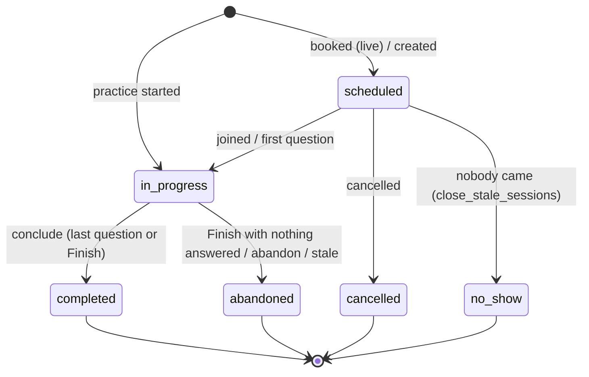

### 18.3 Question (turn) state machine and replay protection

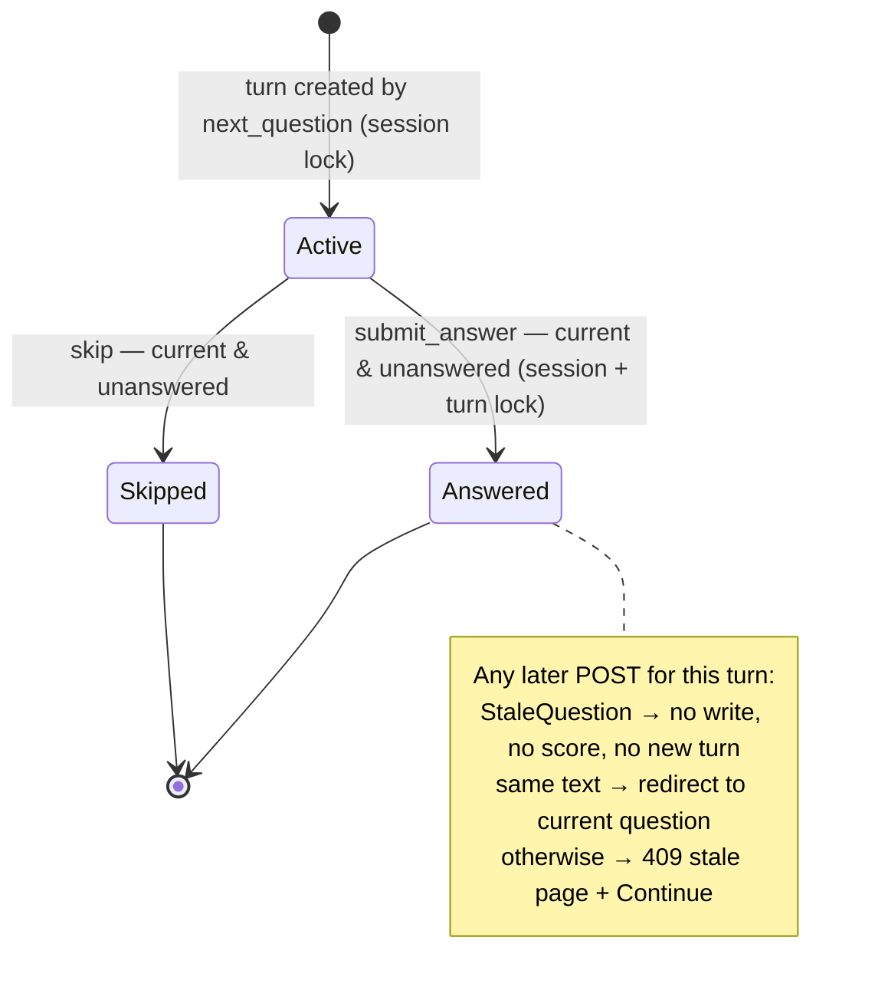

**Replay protection algorithm (implemented 2026-09-28):**
1. **Authoritative state** is the turn rows: the current question is the earliest
   turn with an empty answer (`engine.current_turn`).
2. **Serialisation:** every progression step (`next_question`, `submit_answer`,
   `skip`, `conclude`, `abandon`) first takes `SELECT … FOR UPDATE` on the
   session row. The answer path also locks the turn row. Two tabs or a double
   click therefore run one after the other.
3. **Validation under the lock:** finished → stale; turn answered → stale; turn
   not current → stale.
4. **No duplicate progression:** `next_question` under the lock creates at most
   one new turn (unique `(session, order)` backs it up); `conclude` re-checks
   `is_finished` under the lock, so the evaluation is queued once.
5. **UX:** the question page is sent with `Cache-Control: no-store`, so Back and
   refresh fetch the current question. A page restored from the back/forward
   cache reloads itself (`pageshow`, `static/js/app.js`). A second click while
   submitting is ignored client-side (the server enforces it anyway).
6. **Voice:** `TranscribeAnswerView` refuses a recording for a non-current
   question (409, `stale: true`). The final submission goes through the same
   `submit_answer` check.

Verified:
- **Tests** (`apps/interviews/tests/test_question_replay.py`): real endpoints,
  including a `TransactionTestCase` with two threads. It fails without the locks
  (`[302, 302]` and a duplicate question) and passes with them.
- **Built-in browser, 2026-09-28:** real Back button → current question shown;
  forced old-form submit → stale page; database shows the first answer intact,
  one Q2 answer despite a double click, and one Q3.

### 18.4 Other interview mechanics
- **Job-aware context:** questions come from the posting's kit (`planning.plan_job`,
  cached per posting digest) or from the posting itself when no kit exists yet;
  otherwise general pools.
- **Timing:** `ANSWER_SECONDS = 240` suggested per answer (running over is
  recorded, never scored); `MAX_ANSWER_CHARS = 6000`.
- **Integrity metrics** (pastes, blur events, keystrokes) are stored, shown to the
  candidate as declared, and never sent to the evaluator.
- **Scoring retries:** `recover_unscored_sessions` every 10 min.
- **Stale sessions:** `close_stale_sessions` (defined; not in the beat schedule).
- **Live interviews:** join tokens hashed (`join_token_hash`); JaaS RS256 room
  tokens; `FakeRoomProvider` default; production check refuses the fake
  (`interviews.E001`) and incomplete JaaS (`E002`).


---

## 19. Security architecture

| Mechanism | Purpose | Implementation | Source | Evidence |
|---|---|---|---|---|
| Password hashing | Resist offline cracking | Argon2 first (`Argon2PasswordHasher`), PBKDF2/scrypt accepted for upgrade | `config/settings/base.py::PASSWORD_HASHERS` | Django auth tests |
| Email verification | Prove address ownership | Signed single-use token (`issue_verification_token`, consumed in `ConsumedToken` ledger, purpose `EMAIL_VERIFICATION`) | `apps/accounts/services/identity.py` | accounts tests |
| Sign-up enumeration resistance | Do not reveal registered emails | Same response for new/existing; owner of an existing address is emailed instead (D-12) | `apps/accounts/views.py` | tests |
| Password reset | Recover access safely | Rate limited (3/h per identity, 10/h per IP), same answer whether the account exists, token link; all sessions revoked on reset (`revoke_all_sessions`) | `identity.py` | tests |
| MFA | Second factor for high-privilege users | django-otp TOTP + static recovery codes; mandatory for staff, company owners and admins after a 14-day grace (`mfa_policy.GRACE_DAYS`); `MfaRequirementMiddleware`; login code challenge | `apps/accounts/mfa_policy.py`, `middleware.py` | tests |
| Session management | Visibility and revocation | `UserSession` rows per session (IP, user agent); revoke one or all; cached-DB session store; cookies HttpOnly, SameSite=Lax, Secure in prod | `apps/accounts/sessions.py`, settings | IDOR sweep: foreign session ids refused without writes |
| Company authorization | Role-based access inside a company | `CompanyContextMiddleware` binds company + active membership from the URL slug (no membership → 404, never 403); `permissions.require(grant)`; assignment scoping | `apps/companies/middleware.py`, `permissions.py` | `matrix()` test: every grant has a negative test |
| Staff authorization | Platform operator levels | `StaffRole.level` ordered; `is_staff` alone grants nothing outside Django admin | `apps/accounts/staff.py` | staff portal tests |
| Object ownership / IDOR | No access by guessing ids | UUID `public_id` in URLs; selectors filter by owner in the query (`document_for(profile, id)`) | selectors | `scripts/idor_sweep.py` 0 leaks |
| CSRF | Forged posts | Django CSRF middleware; trusted origins from env (`DJANGO_CSRF_TRUSTED_ORIGINS`) | settings | hostile-form sweep |
| XSS | Script injection | Django autoescaping; CSP `script-src 'self' 'nonce-…'` (no `unsafe-inline` for scripts); Alpine CSP build | `apps/common/csp.py` | HTML integrity sweep |
| Clickjacking | Framing | `X_FRAME_OPTIONS = "DENY"`, CSP `frame-ancestors 'none'` | settings, csp | — |
| Transport | Encryption in transit | Prod: SSL redirect, HSTS 30 days incl. subdomains + preload, secure cookies, proxy header | `config/settings/prod.py` | deploy check |
| Open redirect | Redirect abuse | `url_has_allowed_host_and_scheme` on `next` and referer use | `accounts/views.py`, `common/fragments.py`, errors middleware | tests |
| Upload validation | Malicious files | Size limit, byte sniffing, DOCX container inspection, ClamAV, private storage | `apps/files` | files tests |
| File access control | Private documents | Signed 5-min single-use token + live policy re-check + scan-clean + access log | `apps/files/signing.py`, `policies.py` | files tests |
| Field encryption | Protect phone numbers at rest | `cryptography`-based field encryption, keys `FIELD_ENCRYPTION_KEYS` | candidates | — |
| Prompt-injection | Model manipulation | Fenced data, instruction pre-filter, grounding post-filters, suggestions only | §15, §16 | assistant/evaluation tests |
| Hostile input | Malformed data | Services validate; `ValidationError` from the ORM → 400 with a sentence (never 500) | `errors_middleware.py` | post sweep 0 failures |
| Rate limiting | Abuse and brute force | 14 rules; fail closed | `apps/common/ratelimit.py` | tests |
| Concurrency controls | Races | `select_for_update` (interview progression, improvement jobs, invites, ownership); partial unique constraints (one live application, one active job, one open invite, one pending transfer); optimistic `row_version` | services | concurrency tests |
| Idempotency | Duplicate submissions | `IdempotencyKey`; one-time form tokens on improvement jobs; stale-question same-answer handling | `apps/common/idempotency.py` | tests |
| Audit logging | Accountability | `AuditLog` (actor, on-behalf-of for impersonation, target, company, metadata) via `audit.record` | `apps/audit` | tests |
| Impersonation | Support with accountability | Staff impersonation recorded on every audit row (`on_behalf_of`); stop control | `apps/accounts/impersonation.py` | tests |
| Privacy | Candidate control | Profile visibility (everyone/employers/nobody), contact permission, blocks (mutual invisibility), visibility grants, consents, data export (JSON/ZIP), erasure after 14 days (`run_due_erasures`), retention purges | candidates, accounts, tasks | tests |
| Account isolation | Company data separation | Company-scoped URLs and querysets; blocks exclude from audiences | companies, notifications | IDOR sweep |
| Subscription enforcement | Server-side plan limits | `entitlements.require`; the UI only describes limits | billing | tests |
| Webhook SSRF posture | Outbound calls | Signed body, short timeout, `allow_redirects=False` | notifications | tests |

**Rate-limit rules:** `login.identity` 5/15 min · `login.ip` 20/15 min · `signup.ip`
5/h · `signup.notice` 3/h · `reset.identity` 3/h · `reset.ip` 10/h · `upload.user`
20/h · `ai.user` 30/h · `application.user` 50/day · `search.candidates` 30/min ·
`message.pair` 20/day · `message.company` 200/day · `webhook.endpoint` 120/min
(fail-open) · `search.jobs` 60/min (fail-open).

---

## 20. Permission / role matrix

### 20.1 Company grants (from `apps/companies/permissions.py::ROLE_GRANTS`)

| Grant ↓ / Role → | Owner | Admin | Recruiter | Hiring manager | Interviewer | Viewer |
|---|---|---|---|---|---|---|
| `job.publish` | ✔ | ✔ | ✔ | — | — | — |
| `job.write_any` | ✔ | ✔ | — | — | — | — |
| `application.read_any` | ✔ | ✔ | — | — | — | ✔ |
| `application.decide` | ✔ | ✔ | ✔ | — | — | — |
| `offer.send` | ✔ | ✔ | — | — | — | — |
| `candidate.search` | ✔ | ✔ | ✔ | — | — | — |
| `candidate.export` | ✔ | ✔ | — | — | — | — |
| `team.invite` | ✔ | ✔ | — | — | — | — |
| `company.edit` | ✔ | ✔ | — | — | — | — |
| `billing.manage` | ✔ | — | — | — | — | — |

Notes:
- Extra grants can be layered per membership (`CompanyMembership.permissions`,
  validated).
- Recruiters and hiring managers see applicants of jobs they are assigned to
  (`JobAssignment`; decision D-13; strict scoping flag
  `Company.strict_assignment_scoping`).
- A Company Admin can open billing to view but not change it (D-11).
- Hiring managers and interviewers act through assignments and interview
  participation, not preset grants.

### 20.2 Whole-platform matrix

| Resource | Candidate | Owner | Admin | Recruiter | Viewer | Staff support | Staff moderator | Staff admin | Staff superadmin | Django admin (`is_staff`) |
|---|---|---|---|---|---|---|---|---|---|---|
| Own CVs, analyses, suggestions | full | — | — | — | — | — | — | — | — | admin site only |
| Applications (own) | create, withdraw, read | — | — | — | — | read (support views) | | | | |
| Jobs | read published | full | full | publish, edit assigned | read | read | act | | | |
| Applicants | — | full | full | assigned jobs, decide | read any | | | | | |
| Interviews | own sessions | manage, score | manage, score | manage (assigned) | read | | | | | |
| Company profile & verification | — | edit, submit | edit, submit | — | — | read | decide verification | | | |
| Team | — | invite, roles, transfer | invite, roles | — | — | read | act on companies | | | |
| Billing | own plan | manage | view | — | — | | | | | |
| Talent search | — | ✔ | ✔ | ✔ | — | | | | | |
| Notifications | own | own | own | own | own | | | | | |
| Staff operations / companies / people | — | — | — | — | — | read | read | read | read | |
| Verification queue, anomalies | — | — | — | — | — | — | ✔ | ✔ | ✔ | |
| Staff team (grant roles) | — | — | — | — | — | — | — | — | ✔ | |
| Platform configuration (flags, taxonomy curation) | — | — | — | — | — | — | — | ✔ (admin level) | ✔ | Django admin site |

Staff view levels (from code): companies, people, operations → `support`;
verification queue, verification documents, anomalies → `moderator`; staff team
→ `superadmin`.

---

## 21. State machines

| Machine | States | Main transitions (trigger) | Terminal |
|---|---|---|---|
| Account | active → erasure requested → erasure started → erased | request erasure; `run_due_erasures` after 14 days | erased |
| Email address | unverified → verified | verification link | verified |
| Company | active ↔ suspended | staff action | — |
| Company verification | not_submitted → pending → more_info → pending → verified \| rejected | submit (complete checklist); staff decision; re-apply after wait | verified, rejected (until re-apply) |
| Invitation | open → accepted \| revoked \| expired | accept (locked row); revoke | accepted, revoked |
| Ownership transfer | pending → accepted \| declined \| cancelled | nominee responds; nominator cancels | all but pending |
| Membership | active ↔ suspended; removed (soft delete) | role change, remove | removed |
| Staff role request | pending → approved \| declined \| withdrawn | superadmin decision | all but pending |
| Attachment scan | pending → clean \| infected \| error | scan task; requeue | clean, infected |
| CV upload parse | blocked → pending → running → parsed \| failed \| unsupported | scan clean; parse task; stall requeue | parsed, failed, unsupported |
| Import proposal | offered → accepted \| rejected \| superseded | candidate | all but offered |
| CV analysis enrichment | skipped \| pending → ok \| failed | async enrichment; stall sweep; free retry | ok, failed |
| Suggestion | offered → accepted \| rejected \| superseded | candidate; newer proposal | all but offered |
| Improvement job | queued → processing → waiting_ai → processing → completed \| failed; failed → queued (retry) | worker stages; stall (10 min) | completed |
| Job | draft → published ↔ paused → closed \| expired → archived | employer; `expire_due_jobs` hourly; staff take-down | archived |
| Application | stage: new → reviewing → shortlisted → interview → offer → hired \| declined (company stages configurable); withdrawn/closed timestamps | employer moves; candidate withdraws | hired, declined, withdrawn |
| Offer | draft → sent → accepted \| declined \| withdrawn \| expired | employer; candidate; `expire_due_offers` hourly | all but draft/sent |
| Interview slot | open → held → booked \| cancelled | booking; `sweep_holds` returns expired holds | booked, cancelled |
| Interview session | §18.2 | | completed, abandoned, cancelled, no_show |
| Interview turn | active → answered \| skipped | §18.3 | answered, skipped |
| Subscription | trialing/active → past_due → expired; active → cancelled (at `cancel_at`); pending_plan switch at period end | billing tasks | expired, cancelled |
| Invoice | draft → open → paid \| void \| uncollectible | issue; payment recorded; dunning | paid, void, uncollectible |
| Payment | pending → succeeded \| failed \| refunded | manual record | — |
| Notification | unread → read | open / mark read | read |
| Notification delivery | pending → sent \| suppressed \| muted \| failed | channel layer | all but pending |
| Email message | queued → sent \| failed \| suppressed | email backend; suppression list | — |
| Fan-out job | pending → running → done \| failed | `run_fanout` | done, failed |
| Conversation | open → archived \| blocked | participants | — |
| Conversation report | open → reviewing → upheld \| dismissed | staff | upheld, dismissed |
| AI run | pending → ok \| schema_error \| provider_error \| timeout \| quota_exceeded \| refused \| disabled \| erased \| not_asked | runner | all but pending |

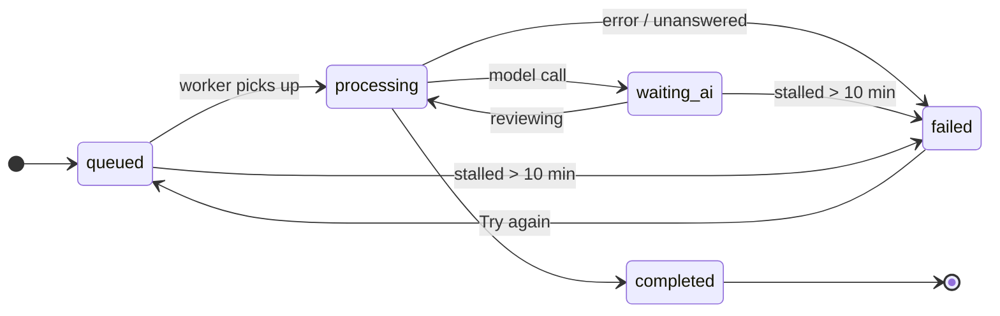

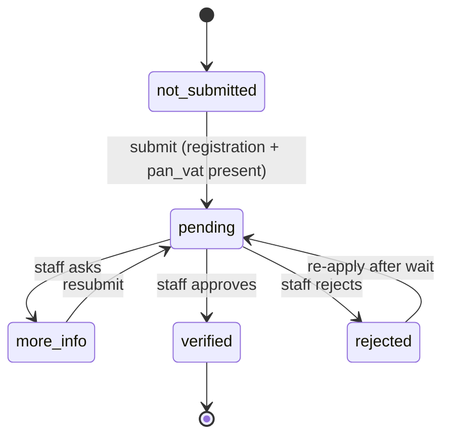

---

## 22. Important endpoints

550 URL patterns exist, of which 403 belong to the Django admin. Important
application flows:

| Method | URL | Auth / authorization | Input | Output / side effects | Idempotency / errors |
|---|---|---|---|---|---|
| GET/POST | `/accounts/signup/` | anonymous | name, email, password ×2, intent | user + verification email → redirect `/accounts/signup/sent/` | 400 invalid (limit not consumed); 429 limit |
| GET/POST | `/accounts/login/` (+ `/accounts/login/code/`) | anonymous | email, password; TOTP | session | 429 limits; MFA challenge |
| POST | `/accounts/password/reset/` | anonymous | email | email if the account exists | same answer either way |
| POST | `/cv/upload/receive/` | candidate | file | Attachment + ResumeUpload; scan queued | duplicate file returns the existing upload |
| GET | `/cv/upload/progress-chip/` | candidate | — | progress fragment | read-only |
| POST | `/cv/upload/import/` | candidate (owner) | accept/reject/accept_all/build | proposals decided / document created | 404 foreign |
| POST | `/cv/analysis/run/` | candidate, plan quota | document, role/job/advert | version frozen, analysis saved, enrichment queued | 402 plan limit |
| POST | `/cv/analysis/fix/` | owner | finding / suggestion id | suggestion drafted / accepted / rejected | 409 decided |
| POST | `/cv/builder/<doc>/act/` | owner, editable | `command` (autosave, contact, bullets, template, turn, improve_*, job_retry, …) | editor region + `HX-Trigger` events | 404 foreign; optimistic lock conflict; tokens on jobs |
| GET | `/cv/builder/<doc>/job/` | owner | `watching` | job panel; `improve:done` when finished | read-only |
| GET | `/cv/builder/<doc>/improve/` | owner | `mode` | plan panel | read-only |
| POST | `/cv/templates/act/` | candidate | favourite/compare/apply | session state / template applied → editor (full page) | 402 Pro template |
| GET | `/cv/templates/<slug>/[?cv=<doc>]` | candidate | own document optional | sample or own preview | 404 foreign doc |
| POST | `/jobs/<slug>/apply/` | candidate | CV version, answers, letter | Application + snapshots + event | one live per job (constraint); 50/day |
| POST | `/jobs/company/<slug>/follow/` | candidate | — | CompanyFollow toggled | unique follow |
| GET | `/jobs/matched/` | candidate | filters | ranked matches with breakdown | — |
| POST | `/interviews/practice/` | candidate | template, job, mode | session (or resume unfinished) | reuse unfinished |
| GET | `/interviews/<id>/` | session owner | — | current question (`no-store`) | lock; one new turn |
| POST | `/interviews/<id>/` | session owner | turn, answer / skip, integrity, delivery seal | answer saved → redirect | stale → 409 page; same answer → redirect |
| POST | `/interviews/<id>/transcribe/` | owner, voice session | audio ≤ limit | transcript + sealed delivery (JSON) | 409 stale / finished; 413 large; 415 not audio; 429 attempts |
| POST | `/interviews/<id>/finish/` | owner | finish / abandon | conclude (evaluation queued once) | locked |
| GET | `/files/<uuid>/?token=…` | token + policy | — | file bytes | single use; 404 otherwise |
| POST | `/employer/new/` | signed-in user | company fields | Company + owner membership | — |
| POST | `/employer/<slug>/verification/` | `company.edit` | documents, submit | verification pending | checklist enforced |
| GET/POST | `/employer/<slug>/jobs/new/` | `job.publish` | job fields, skills | Job (draft/published) + event | constraints |
| POST | `/employer/<slug>/applicants/<id>/act/` | `application.decide` or assignment | stage move, note, tag, rating | ApplicationEvent + notifications | — |
| POST | `/employer/invites/<token>/` | signed-in invitee | accept | membership | locked invite |
| GET/POST | `/staff/verification/` | staff ≥ moderator | claim/release/decide | decision + audit + notification | conflict of interest refused |
| POST | `/dashboard/plan/start/` | candidate | plan code | subscription/invoice or scheduled downgrade | overdue blocks paid plans |
| POST | `/sponsored/hide/` | any | key | session list | htmx → empty; page → redirect |
| GET | `/healthz`, `/readyz` | public | — | liveness; readiness (dependencies) | — |

---

## 23. Background jobs

Queues: `default`, `ai`, `render`, `files`, `email`, `match`. Beat schedules: 29.

| Task | Queue | Trigger | Purpose | Retries / limits | Idempotency | AI |
|---|---|---|---|---|---|---|
| `files.scan_attachment` | files | after upload (on_commit) | ClamAV scan | 3 retries, 30 s, acks_late | state machine | — |
| `files.requeue_stalled_scans` | files | every 10 min | recover lost scans | — | re-asks pending | — |
| `files.purge_attachments` | files | daily 03:30 | delete bytes of deleted/expired | — | — | — |
| `resumes.parse_upload` | default | scan clean | deterministic parse | 3 retries with backoff on OSError | parse state | — |
| `resumes.sweep_unclaimed_uploads` | default | hourly :17 | delete guest uploads past retention | — | — | — |
| `resumes.render_version` | render | export/apply | PDF/DOCX render | 2 retries, acks_late | one render per (version, template, format) | — |
| `resumes.analyse_version` | ai | analysis off-request | full analysis | 1 retry | — | yes |
| `resumes.enrich_analysis` | ai | after deterministic report | AI written review | 2 retries | enrichment state | yes |
| `resumes.run_improvement_job` | ai | improvement job queued | assistant answer / safe rewordings | none automatic (user retry) | locked, `skip_locked`, state check | yes |
| `resumes.purge_expired_renders` | default | daily 03:05 | retention | — | — | — |
| `resumes.recover_stalled_resume_work` | default | every 10 min | re-queue parses, fail stale reviews and jobs | — | — | — |
| `interviews.plan_job_interview` | ai | posting needs a kit | write the kit | soft time limit | cached per posting digest | yes |
| `interviews.evaluate_session` | ai | conclude (on_commit) | score competencies | soft time limit | once per session (conclude lock) | yes |
| `interviews.recover_unscored_sessions` | default | every 10 min | re-queue scoring | — | — | — |
| `interviews.send_reminders` / `sweep_holds` / `close_stale_sessions` | default | defined, **not in beat schedule** | reminders / release holds / close sessions | — | — | — |
| `interviews.purge_old_transcripts` | default | weekly Sun 04:30 | retention | — | — | — |
| `matching.embed_job` / `embed_profile` | ai | on change | vectors | — | model name stored | yes (embedding) |
| `matching.backfill_embeddings` | default | defined, not scheduled | backfill | — | — | — |
| `ai.run_task` | ai | generic off-request run | — | — | — | yes |
| `ai.purge_run_snapshots` | default | daily 04:15 | clear input snapshots (400 days) | — | — | — |
| `notifications.drain_outbox` | default | (outbox_worker process drains continuously) | deliver events | — | consumer runs unique | — |
| `notifications.run_fanout` | default | every minute | large audiences in chunks | — | chunk claims | — |
| `notifications.deliver_webhooks` | default | every 2 min | signed webhook POSTs with retry schedule | per delivery | — | — |
| `notifications.send_digests` | email | Mondays 08:00 | weekly digest | — | — | — |
| `notifications.purge_outbox` | default | defined; purge also via command | retention | — | — | — |
| `jobs.expire_due_jobs` | default | hourly :07 | close expired postings | — | — | — |
| `jobs.run_job_alerts` | default | daily 06:00 / weekly Mon 06:15 | saved-search alerts | — | `JobAlertMatch` unique | — |
| `applications.expire_due_offers` | default | hourly :23 | expire offers | — | — | — |
| `applications.sweep_stale_applications` | default | daily 07:30 | count untouched applications | — | — | — |
| `applications.purge_closed_applications` | default | weekly Sun 04:50 | remove personal content of long-closed applications | — | — | — |
| `billing.renew_due` / `chase_overdue` / `end_cancelled` / `end_unpaid` | default | daily 02:00 / 02:15 / 02:30 / 02:45 | subscription lifecycle | — | per period (invoice unique per period) | — |
| `billing.prune_usage` | default | monthly (1st, 04:45) | delete old usage counters | — | — | — |
| `accounts.run_due_erasures` / `resume_interrupted_erasures` | default | hourly :41 / daily 05:05 | account erasure | — | resumable | — |
| `analytics.run_rollups` / `measure_steering` / `prune_events` | default | 01:10 / 01:40 / 03:50 daily | analytics | — | idempotent per day | — |
| `analytics.backfill_rollups` | default | manual | recompute | — | — | — |
| `common.purge_soft_deleted` | default | daily 03:10 | retention | — | — | — |
| `core.report_expired_flags` | default | Mondays 08:30 | flag hygiene | — | — | — |

---

## 24. Notification architecture

- **Events:** registered with schema version, required payload keys, audience,
  preference group, title/body templates and a dedupe key
  (`apps/notifications/events.py::register`; e.g. `apps/jobs/events.py`).
- **Emission:** `events.emit()` writes an `OutboxEvent` in the same transaction
  as the domain change, so a rolled-back change never notifies.
- **Delivery:** `outbox_worker` drains after commit; each consumer runs once per
  event (`outbox_run_once_per_consumer`).
- **Audience resolution:** 14 named audiences (`event_actor`,
  `application_candidate`, `application_company_team`, `payload_users`,
  `company_team`, `company_editors`, `conversation_other_side`,
  `saved_search_owner`, `saved_job_holders`, `company_followers`,
  `session_candidate`, `account_owner`, `subscription_owner`,
  `interview_participants`).
- **Preferences and mutes:** per user and event key (`NotificationPreference`),
  applied by the channel layer; preference groups such as `company_updates`,
  `job_matches`.
- **Blocking:** a candidate who blocked a company is excluded (e.g.
  `company_followers`).
- **Temporal correctness:** followers only if the follow predates the event.
- **Deduplication:** `NotificationDelivery` unique per (event, recipient,
  channel); `Notification` unique per (recipient, dedupe key) while unread;
  `job.published` dedupes per posting (re-publishing is not a second
  announcement).
- **Persistence:** `Notification` (title, body, url, read state), `EmailMessage`
  records with `EmailSuppression`.
- **Channels:** in-app, email (console backend unless configured), webhooks
  for companies (`WebhookEndpoint`, signed deliveries).
- **Links:** notification open via `/notifications/<uuid>/open/`, marking it read.
- **Unread state:** bell count in the header (signed-in users only).

---

## 25. Billing and plan logic

| Plan (`manage.py seed_plans`) | Audience | Price | Limits |
|---|---|---|---|
| Free | candidate | 0.00 / month | 1 CV analysis per month; free templates; **no downloads**; AI cost ceiling 2.00/month |
| Pro | candidate | 12.00 / month | unlimited analyses; every template; PDF + DOCX export; AI ceiling 20.00/month |
| Employer | company | 0.00 / month (quoted "Talk to us") | unlimited active jobs; candidate search; Pro templates; exports; AI ceiling 50.00/month |

Behaviour (decision D-08; ADR-A15):
- **Upgrade (Free → Pro):** starts immediately on a new period with an invoice for
  the whole period. No proration.
- **Downgrade (Pro → Free):** scheduled for the end of the period
  (`pending_plan`); Pro keeps working and its invoice stays due.
- **Cancel:** `cancel_at` = period end; "Keep my plan" resumes.
- **Overdue:** `chase_overdue` → `past_due`. A plan keeps working during grace;
  `end_unpaid` withdraws it afterwards. An overdue invoice blocks new or paid
  plans (shown on the plan page).
- **Enforcement:** server-side `entitlements.require`. The UI only describes
  limits (Pro template lock panel, upgrade restriction page).
- **Payment:** an open NPR invoice can be paid through eSewa or Khalti in
  **sandbox mode** (ADR-A58, §44), or by bank transfer recorded by staff
  (`recorded_by`). A `PaymentAttempt` is written before the customer leaves;
  only the gateway's server-side status check decides the outcome; success goes
  through `payments._record`, so the invoice is marked paid and a past-due
  subscription is reactivated in the same transaction. USD invoices (the current
  Pro price) are bank transfer only, because both wallets settle in NPR.
- **Employer billing:** Owner manages (`billing.manage`); Admin views (D-11).

---

## 26. File and document architecture

| Kind | Stored as | Visibility | Access |
|---|---|---|---|
| Uploaded CV | `Attachment` (private) + `ResumeUpload` | owner | signed token + policy |
| Rendered CV (PDF/DOCX) | `ResumeRender` → `Attachment` | owner; the applied-to company for the submitted version | signed token; application grants |
| Verification documents | `CompanyVerificationDocument` → `Attachment` (PROTECT) | company editors, staff | staff view level moderator |
| Offer letters | `Offer.attachment` | parties | policy |
| Message attachments | `Message.attachments` (M2M) | conversation parties | policy |
| Company logo, template preview | public attachments | public | media URL |

- **Scanning:** every private upload passes ClamAV before use.
- **Downloads:** exports via `/cv/exports/<id>/` (Pro entitlement).
- **Access log:** `AttachmentAccess` records each read.
- **Retention:** `purge_attachments`, `purge_expired_renders`, soft-delete purge,
  closed-application purge.
- **Object storage:** NOT IMPLEMENTED (local filesystem only).

---

## 27. Front-end architecture

| Aspect | Implementation |
|---|---|
| Rendering | Django templates; layouts `base.html`, `layouts/app.html` (signed-in shell with left rail, no footer), `layouts/page.html` (marketing pages), `layouts/auth.html`, `layouts/builder.html` |
| CSS | Tailwind v4 design system in `static/css/src/input.css`: semantic tokens (`--color-content`, `--color-surface`, …) mapped from `--ui-*` per theme; components (`.btn`, `.card`, `.panel`, `.badge`, `.alert`, `.stack`, `.demo-ad`); light/dark via `.dark` on `<html>`; `.on-photo` inverted regions |
| Typography | Newsreader (serif, headings/display) and Inter (UI), self-hosted (`static/fonts`) |
| Interactivity | htmx (region swaps, polling `every 2s`, `HX-Trigger` events); Alpine.js CSP build (components registered in `static/js/app.js`, e.g. `interviewTurn`, `disclosure`) |
| Fragments vs pages | htmx gets fragments; plain form posts get pages (`common/fragments.py`) |
| Loading/progress | `.btn.htmx-request` / `.is-busy` spinners; upload progress chip; improvement job stage panel (`_improvement_job.html`, `role=status`, `aria-live`) |
| Restrictions vs errors | `components/restriction.html` / `restriction.html` (plan, permission, state, limit, input) vs error alerts |
| Responsive | Mobile-first Tailwind; container queries in the CV editor (`@container`, `@3xl:`…); verified no overflow at 320/375 px |
| Accessibility | Labelled controls, landmarks, heading order, visible focus, `sr-only` labels, `aria-live` progress; automated axe scans and a static checker (`apps/resumes/tests/test_accessibility.py`) |
| Footer | `templates/partials/footer.html` from `core.navigation.FOOTER_NAV` (Product · For employers · Company · Legal); two columns on phones, five on desktop; feature-flagged links drop out |
| Demo ads | `components/demo_ad.html` via `` (§28) |

---

## 28. Demo advertisement system

**These are demonstration ads, not an advertising network.** IMPLEMENTED 2026-09-28.

| Aspect | Implementation |
|---|---|
| Data source | `apps/core/ads.py::DEMO_ADS` — `DemoAd(key, advertiser, title, text, cta, monogram, slots, active, label="Advertisement · Demo")`; two fictional advertisers ("Example Learning Platform", "Sample Certification Program") |
| Component | `templates/components/demo_ad.html` (card and row variants); template tags `` and `` (`apps/core/templatetags/demo_ads.py`) |
| Feature flag | `demo_ads` (on by default) in `DEFAULT_FEATURES` — off disables every slot |
| Placements | Jobs list (after the 5th result, or under a shorter list); candidate dashboard side column (active accounts); bottom of the CV analysis page |
| Intentional exclusions | Interview questions, CV editor/guided/assisted, uploads, sign-in/sign-up, plan & pricing, employer pages, new-user onboarding dashboard |
| Hide | "Hide" button (`POST /sponsored/hide/`): htmx swaps the ad out; without JS the page reloads; remembered in the session only (`demo_ads_hidden`) |
| "Learn more" | `/sponsored/<key>/` — a page on this site saying the ad was a demonstration |
| No tracking | No third-party scripts, images, pixels, ad cookies, profiling or network calls; `rel="sponsored"`; tests assert no `<script>`, `` or external URLs inside an ad |
| Layout stability | Server-rendered in reserved space; no pop-up, overlay, animation or autoplay |
| Accessibility | `<aside aria-label="Advertisement (demo): …">`, decorative monogram `aria-hidden`, labelled Hide button |
| Tests | `apps/core/tests/test_footer_and_ads.py` |

---

## 29. Testing strategy

| Layer | What | Where / tool |
|---|---|---|
| Unit / service | domain rules, scoring, parsing, taxonomy, entitlements | `apps/*/tests` (Django `TestCase`) |
| Model / constraint | partial unique constraints, checks | model tests; database constraints tested by `IntegrityError` |
| Endpoint / screen | real URL routes with the test client, htmx headers, full-page navigation headers | `portals/*/tests`, `apps/*/tests/test_screens.py` |
| Permission | role grant matrix: every grant has a negative test; IDOR within tests | companies/applications tests |
| Concurrency | real threads with `TransactionTestCase` (interview submissions and next-question creation) | `apps/interviews/tests/test_question_replay.py` |
| AI | `FakeAdapter` through the real runner (no mocked runner); schema, fallbacks, failures, grounding | `apps/ai/tests`, `apps/resumes/tests/test_assistant.py`, `test_analysis.py`, interview evaluation tests |
| AI evals | eval sets in `prompts/evals` | `manage.py run_evals` |
| Benchmarks | parsing corpus, interview benchmark, model benchmark | `resume_benchmark`, `interview_benchmark`, `scripts/decision_benchmark.py` |
| Query budgets | ≤ 25 queries on key pages | `apps/common/tests/test_query_budgets.py` |
| Static checks of templates | every CSS class exists in the built stylesheet; accessibility static checker | `apps/core/tests/test_css_classes.py`, `test_accessibility.py` |
| Browser (automated) | Playwright flows, axe-core scans, overflow at 320/375 px | `scripts/*_a11y.py` |
| Sweeps | links, HTML integrity, IDOR, hostile forms, notifications links | `scripts/link_sweep.py`, `html_integrity_sweep.py`, `idor_sweep.py`, `post_sweep.py`, `notification_link_sweep.py` |
| Migration checks | `makemigrations --check`, `migrate --check` | CI-style commands |
| Static analysis | ruff, mypy | `pyproject.toml` |
| Manual | 10 demo accounts, manual test plan | `var/manual-testing/` (git-ignored), `docs/benchmarks/Manual-Testing-Handoff.md` |

**Final count (Part A):** **4,058 tests, 0 failures, 0 errors** (Ran 4058 tests in 2,114.9 s — OK).
Test methods per package (`def test_` count, before sub-tests):

| Package | Tests | Package | Tests |
|---|---|---|---|
| apps/resumes | 645 | apps/matching | 180 |
| apps/interviews | 472 | apps/common | 171 |
| apps/applications | 261 | apps/notifications | 164 |
| portals/candidate | 251 | portals/employer | 148 |
| apps/candidates | 237 | apps/core | 125 |
| apps/taxonomy | 212 | apps/accounts | 125 |
| apps/companies | 199 | apps/ai | 118 |
| apps/billing | 196 | apps/messaging | 103 |
| apps/jobs | 189 | portals/staff | 100 |
| apps/analytics | 85 | apps/files | 61 |
| apps/audit | 9 | | |

---

## 30. Representative test matrix

| Test ID | Module | Scenario | Input | Expected | Actual | Status | Evidence |
|---|---|---|---|---|---|---|---|
| T-INT-01 | interviews | Browser Back → old question submitted | GET Q1, POST, GET Q2, POST Q1 again | 409 stale page, no write, Q2 current | as expected | Pass | `test_question_replay.BrowserBackTests` |
| T-INT-02 | interviews | Two simultaneous answers | 2 threads POST same turn | exactly one 302, one 409 | `[302, 409]` | Pass | `ConcurrentSubmissionTests` |
| T-INT-03 | interviews | Two tabs load next question at once | 2 threads GET | one new turn | 1 turn | Pass | same |
| T-INT-04 | interviews | Old question after completion | POST after finish | 409, evaluation queued once | as expected | Pass | `CompletedInterviewTests` |
| T-INT-05 | interviews | Voice recording for old question | transcribe answered turn | 409 `stale: true` | as expected | Pass | `VoiceReplayTests` |
| T-CV-01 | resumes | General analysis without target | CV with weaknesses | findings incl. generic summary, thin entry | as expected | Pass | `test_improvement.GeneralFindingsTests` |
| T-CV-02 | resumes | Assisted prepare drafts only rewordings | analysis + fake AI | 2 suggestions, CV unchanged | as expected | Pass | `PrepareJobTests` |
| T-CV-03 | resumes | Reject keeps CV intact | reject shown ids | content unchanged | as expected | Pass | `PrepareJobTests.test_reject…` |
| T-CV-04 | resumes | Nothing drafted that was not said | invented 40% claim | no suggestion | none | Pass | `TurnJobTests` |
| T-CV-05 | resumes | Duplicate submission | same token twice | one job | one | Pass | `TurnJobTests` |
| T-TPL-01 | candidate portal | Gallery never shows own CV | edit CV, reload gallery | sample only | as expected | Pass | `SampleIsolationTests` |
| T-TPL-02 | candidate portal | Pro template for free user | apply by direct post | 402 full restriction page | as expected | Pass | `TemplatePageTests` |
| T-MAT-01 | matching | Missing required skill caps band | score ≥ 85, required missing | band ≤ good | as expected | Pass | `apps/matching/tests` |
| T-SEC-01 | companies | Every grant refused without it | each role × grant | NotAllowed | as expected | Pass | permission matrix test |
| T-SEC-02 | files | Token reuse | second GET with same token | refused | refused | Pass | `apps/files/tests` |
| T-SEC-03 | sweep | Cross-account object access | 6 account pairs | 0 leaks | 0 | Pass | `var/benchmark/idor-sweep.json` |
| T-UI-01 | core | Footer once, links resolve | public pages | 1 footer; 200/302 | as expected | Pass | `test_footer_and_ads.FooterTests` |
| T-UI-02 | core | No ad in active tasks | interview, editor, upload, auth, plan | no `demo-ad` | none | Pass | `DemoAdPlacementTests` |
| T-PERF-01 | common | Builder pages within budget | first visit | ≤ 25 queries | within | Pass | `test_query_budgets` |
| T-A11Y-01 | scripts | axe on affected pages | light/dark 1280 | 0 serious/critical | 0 | Pass | a11y scripts |

---

## 31. Performance

| Measure | Value | Kind | Source |
|---|---|---|---|
| Page query budget | ≤ 25 queries per page (builder, guided, assisted pass) | Measured (tests) | `test_query_budgets.py` |
| Full test suite duration | 2,114.9 s for 4,058 tests (serial, final run 2026-09-29); 1,546 s on 2026-09-28 | Measured | local runs |
| Assisted CV "prepare" (2 rewordings, local qwen2.5:7b) | 56.8 s end to end | Measured 2026-09-27 (browser) | this project's verification |
| Assisted CV answer turn (local model) | ~60 s | Measured 2026-09-27/28 | browser verification |
| Interview kit generation | 224.9 s (history median 273 s; 17% schema errors) | Measured 2026-09-24 | `docs/benchmarks/System-Audit-2026-09-24.md` |
| Interview follow-up | 30.0 s (history median 11.1 s over 149) | Measured 2026-09-24 | same |
| Interview evaluation | 132.8 s for 2 competencies (history median 35.5 s per call, p90 378 s) | Measured 2026-09-24 | same |
| Prompt-based CV builder reply | 38.3–84.3 s (history median 43.2 s) | Measured 2026-09-24 | same |
| Practice session open | 226 ms | Measured 2026-09-24 | same |
| Speech-to-text | median 2.32 s per answer; 4.8% WER on synthetic corpus | Measured | audit; `requirements.in` note |
| Retrieval strategy thresholds | exact < 5,000 rows | Design constant (not a benchmark) | `retrieval.py` |
| Load test | `scripts/loadtest.py` exists | Not measured in this report | — |

All model timings are on CPU with a local 7B model; hosted models were not
measured in this environment.

---

## 32. Error handling

| Situation | Handling |
|---|---|
| Validation error | 400 with the form re-rendered and field errors; rate-limit budget not consumed |
| Authorization failure | Company/staff surfaces: 404 when the actor should not know it exists; `NotAllowed` → restriction with who can help |
| Plan restriction | `PlanLimitExceeded` → "Not included in your plan" with Upgrade + View plans (402); htmx gets a region, full-page posts get a full page |
| Expected refusal vs failure | `common/restrictions.describe`: restrictions are warnings with a next step; failures (`ProviderError`, bugs) keep error treatment and reach logs |
| AI failure / provider outage | Runner classifies it; the next model is tried; the feature degrades (deterministic report, "could not draft", general interview questions); `AIRun` recorded |
| Malformed AI output | Schema validation fails → `schema_error` (stop, or one retry where configured); interview quotes verified |
| Background job failure | Improvement job → failed with a plain message + retry; parse retries; scan retries |
| Stale jobs | Sweeps (10–30 min thresholds) mark failed or re-queue |
| Timeouts | Per task (e.g. interview plan 300 s; Celery soft time limits) |
| Upload failure | Unsupported type, too large, infected, unreadable → message; nothing parsed |
| Interview stale request | 409 stale page with Continue / result; no write |
| Concurrency conflicts | Row locks serialise; `IntegrityError` on partial unique → existing object returned |
| Cache (Redis) down | Rate-limited actions fail closed: "temporarily unavailable" |
| Missing prompt | `PromptMissing` (loud) |

---

## 33. Deployment architecture

| Component | Requirement | Status |
|---|---|---|
| Web | Django WSGI/ASGI (`config/wsgi.py`, `asgi.py`) behind a TLS proxy (`SECURE_PROXY_SSL_HEADER`); `Dockerfile` | Configured; production host EXTERNAL |
| Settings | `config.settings.prod` refuses to start without `DJANGO_SECRET_KEY`, `DJANGO_ALLOWED_HOSTS`, `POSTGRES_PASSWORD` | IMPLEMENTED |
| Database | PostgreSQL 16 + pgvector + pg_trgm | Required |
| Cache/broker | Redis | Required |
| Workers | Celery workers for the six queues; one beat; `outbox_worker` | Required |
| Static files | WhiteNoise; `npm run build` (vendor + Tailwind) | IMPLEMENTED |
| Media / private files | local volumes (`var/public`, private root) | IMPLEMENTED; object storage NOT IMPLEMENTED |
| Scanner | ClamAV daemon (`CLAMAV_HOST`) | EXTERNAL |
| Email | SMTP via env (`DJANGO_EMAIL_BACKEND`, `EMAIL_HOST…`) | EXTERNAL / MANUAL |
| AI | Ollama host and/or `OPENROUTER_API_KEY` | EXTERNAL |
| Video | `VIDEO_ROOM_PROVIDER=…jitsi` + JaaS keys; deploy check refuses fake/incomplete | EXTERNAL / MANUAL |
| Payments | none | DEFERRED |
| Monitoring | JSON logs; `/healthz`, `/readyz` | Logs IMPLEMENTED; APM Not established from the current repository |
| Backups | Not established from the current repository (see `docs/RUNBOOKS.md` for operational notes) | EXTERNAL / MANUAL |
| Deploy guide | `docs/DEPLOYMENT.md` | Documentation exists |

---

## 34. DevOps and operations

| Task | Command / mechanism |
|---|---|
| Migrations | `python manage.py migrate` (checks: `makemigrations --check`, `migrate --check`) |
| Seed data | `seed_taxonomy`, `seed_plans`, `seed_resume_templates`, `seed_interview_templates`, `seed_pipeline_stages`, `seed_legal`, `seed_demo` (`--personas-only` for the 10 manual-testing accounts; refuses to run with DEBUG off) |
| Prompts | `python manage.py load_prompts` (versioned by hash) |
| Workers | `celery -A config worker --queues=… --pool=solo` (Windows dev), `celery -A config beat`, `python manage.py outbox_worker` |
| Scheduled tasks | 29 beat entries (`config/celery.py`) |
| Health | `GET /healthz` (liveness), `GET /readyz` (readiness) |
| Logs | structured JSON (`ts`, `level`, `logger`, `message`, request fields) |
| Maintenance | `purge_consumed_tokens`, `purge_idempotency_keys`, `purge_outbox`, `purge_attachments`, `sweep_resume_uploads`, `reparse_resume_uploads`, `load_fx_rates`, `import_taxonomy` |
| Bootstrap | `bootstrap_superadmin` |
| Benchmarks | `resume_benchmark`, `interview_benchmark`, `run_evals`, `scripts/decision_benchmark.py` |
| Environment | `.env` (git-ignored) / `.env.example`; key variables: `DJANGO_*`, `POSTGRES_*`, `REDIS_URL`, `OLLAMA_*`, `OPENROUTER_API_KEY`, `FILES_SCANNER`, `CLAMAV_HOST`, `VIDEO_ROOM_PROVIDER`, `JAAS_*`, `SPEECH_TO_TEXT_*`, `FIELD_ENCRYPTION_KEYS`, `DJANGO_CSRF_TRUSTED_ORIGINS` |
| Dev ports (this machine) | Postgres 5433, Redis 6380 (a native PostgreSQL holds 5432) |
| Recovery | stall sweeps; retry controls in the UI; `recover_*` tasks |


---

## 35. Limitations and known gaps

### A. Implemented and verified (automated tests + browser verification)
Accounts, MFA, sessions; CV upload/scan/parse/analysis; CV templates with sample
isolation; guided and assisted improvement with persisted jobs; matching;
applications and pipeline; company, verification, team; interviews (text and
voice practice, replay protection); notifications; billing logic; staff portal;
footer; demo ads. Evidence: §0, §29–30.

### B. Implemented — external or manual verification required
- **Live video interviews:** JaaS keys not configured; `FakeRoomProvider` in dev.
- **Email delivery** through a real provider (console backend in dev).
- **ClamAV** scanning in a deployed environment (AllowAll in dev).
- **Hosted AI models** (OpenRouter key absent; only the local model exercised).
- **Voice interview in a real browser with a real microphone:** the endpoints
  are tested, but not a live recording.
- **Human manual test plan** (`var/manual-testing/`): prepared, not executed by
  a person as part of this report.

### C. Deferred by design
- Live payments: gateways run in sandbox mode only (`billing.E001`); going live needs merchant agreements and keys (ADR-A58).
- OCR for image-only CVs (ledger §15/§18).
- Streaming AI responses (answers arrive in one swap; ADR note in `assistant.py`).

### D. Not implemented
- Career roadmap (`career_tools: False`).
- Object storage (local filesystem only).
- Production advertising (only demo ads).
- `match.explain` is not surfaced in any screen (service only).
- `skills.extract` is not used by product flows (eval harness only).
- Scheduled `send_reminders`, `sweep_holds`, `close_stale_sessions`,
  `backfill_embeddings` (tasks exist; not in the beat schedule).
- APM / metrics and automated backups: Not established from the current repository.

### E. Model limitations
- The local qwen2.5:7b-instruct on CPU is slow: interview kits in minutes; about
  a minute per assistant turn.
- Interview scoring by the local model is lenient; deterministic ceilings and
  quote checks limit this, but do not make it an expert assessor.
- The assistant can propose near-duplicate bullets (existing fingerprint dedupe
  is exact-normalised only).
- Kit generation had a 17% schema-error rate in history (2026-09-24 audit).

### F. Infrastructure and repository limitations
- The development machine restarted twice during verification; Docker services
  and workers must be started by hand (no supervisor configured in the repo).
- Celery workers do not auto-reload; they must be restarted after code changes.
- A stray root script `fix_tables.py` (created 2026-09-27 during an abandoned
  SQLite experiment; it `ALTER`s SQLite tables) fails `ruff check .` /
  `ruff format --check .`. It is not part of the application and should be
  deleted by the owner.
- At tablet width (~768 px) the CV editor stacks the preview below the form.
- The IDOR sweep flags a cross-account "revoke session" POST that answers 302
  (not 404) while writing nothing — informational.

---

## 36. Future enhancements (FUTURE WORK)

| Item | Basis in the current code |
|---|---|
| Payment gateway integration | `Payment.provider` / `provider_ref` unique constraint already modelled |
| Hosted AI in production | OpenRouter provider + chains already configured; needs a key and cost policy |
| Real email provider | `EmailMessage`, suppression and digest tasks exist |
| JaaS production verification | provider + deploy checks exist |
| Surface match explanations | `apps/matching/services/explanations.py` |
| OCR for image-only CVs | picture detection already identifies these files |
| Object storage for files | storage abstraction in `apps/files/storage.py` |
| Production sponsorship system | replace `DEMO_ADS` / `for_slot` in `apps/core/ads.py` |
| Scheduling the unscheduled maintenance tasks | tasks listed in §23 |
| Faster local models or GPU hosting | benchmark harness `scripts/decision_benchmark.py` |

---

## 37. Diagrams required for the final report — master index

| ID | Diagram | Purpose | Source section | Main entities / components | Notation |
|---|---|---|---|---|---|
| D01 | System architecture | Layers and components | §3, §38-D01 | Browser, middleware, portals, services, DB, Redis, Celery, AI, external | Component/box diagram |
| D02 | Context diagram | System boundary | §8.1 | Candidate, Employer, Staff, AI, Email, JaaS, ClamAV | DFD context |
| D03 | DFD Level 0 | Same as D02 in Yourdon terms | §8.1 | — | DFD (merge with D02, see note) |
| D04 | DFD Level 1 | Main processes and stores | §8.2 | P1–P14, D1–D14 | DFD |
| D05 | DFD Level 2 — CV processing | Upload → improvement | §8.3 | 2.1–3.4 | DFD |
| D06 | DFD Level 2 — Interview | Plan → outcome | §8.4 | 8.1–8.10 | DFD |
| D07 | ER diagram | Schema | §5.6–5.7 | core entities + sub-diagrams | Crow's-foot ER |
| D08 | Use case | Actors and goals | §6 | 12 actors, 30 use cases | UML use case |
| D09 | Candidate activity | Candidate journey | §9 A1–A4 | upload → apply → interview | UML activity |
| D10 | Employer activity | Hiring workflow | §9 A6 | post → review → interview → offer | UML activity |
| D11 | CV processing flowchart | Pipeline decisions | §7 F2–F4 | upload, scan, parse | Flowchart |
| D12 | Job matching flowchart | Retrieval + scoring | §7 F6–F7 | filters, strategy, score, band | Flowchart |
| D13 | Assisted CV flowchart | Plan → apply/reject | §7 F9 | plan, jobs, suggestions | Flowchart |
| D14 | Interview flowchart | Serve/answer/score | §7 F12–F17 | engine, evaluator | Flowchart |
| D15 | Interview state machine | Session + turn states, replay rule | §18.2–18.3 | states | UML state |
| D16 | Interview sequence | Answer incl. stale case | §10-C | browser, view, engine, DB | UML sequence |
| D17 | CV upload sequence | Upload to proposals | §10-A | view, files, storage, worker, ClamAV, parser | UML sequence |
| D18 | AI improvement sequence | Prepare → apply | §10-B | view, jobs, worker, runner, model | UML sequence |
| D19 | Notification sequence | Follow → new-job notice | §10-E | follows, jobs, outbox, audience | UML sequence |
| D20 | Security / authorization flow | Company + staff + file checks | §7 F24–F25, §19 | middleware, grants, policies | Flowchart |
| D21 | Deployment diagram | Runtime nodes | §33, §38-D21 | web, workers, beat, DB, Redis, ClamAV, Ollama | UML deployment |
| D22 | AI architecture | Runner pipeline | §15, §38-D22 | runner, prompts, chain, providers, AIRun | Component + flow |
| D23 | CV processing pipeline | Linear stages | §17 | stages and states | Pipeline/flow |
| D24 | Recommendation / matching pipeline | Candidate → ranked jobs | §7 F6–F7, §11 ALG-06–11 | taxonomy, credit, retrieval, scoring | Pipeline/flow |

**Redundancy notes.** D02 and D03 describe the same boundary; draw one figure and
label it "Context diagram (DFD Level 0)". D11 and D23 overlap: use D23 in the
design chapter and D11 (with decisions) in the implementation chapter, or merge
them. D12 and D24 likewise: D24 as the high-level pipeline, D12 for decisions.

---

## 38. Exact diagram instructions (diagrams not already given in Mermaid above)

### D01 — System architecture
**Purpose:** show the layers and runtime components.
**Components:** Browser (templates, htmx, Alpine, Tailwind) · Django (middleware
chain, 3 portals, 17 domain apps) · PostgreSQL (+pgvector, pg_trgm) · Redis ·
Celery workers (6 queues) · Celery beat · outbox_worker · AI runner → Ollama /
OpenRouter · faster-whisper · ClamAV · JaaS · Email.
**Connections:** Browser → Django (HTTP/htmx); Django → PostgreSQL (ORM);
Django → Redis (cache, sessions, rate limits); Django → Celery (tasks after
commit); Celery → PostgreSQL; Celery → AI runner → providers; Django → ClamAV
(via files worker); Django → faster-whisper (voice); Django → JaaS (join tokens);
outbox_worker → notifications → Email/webhooks.

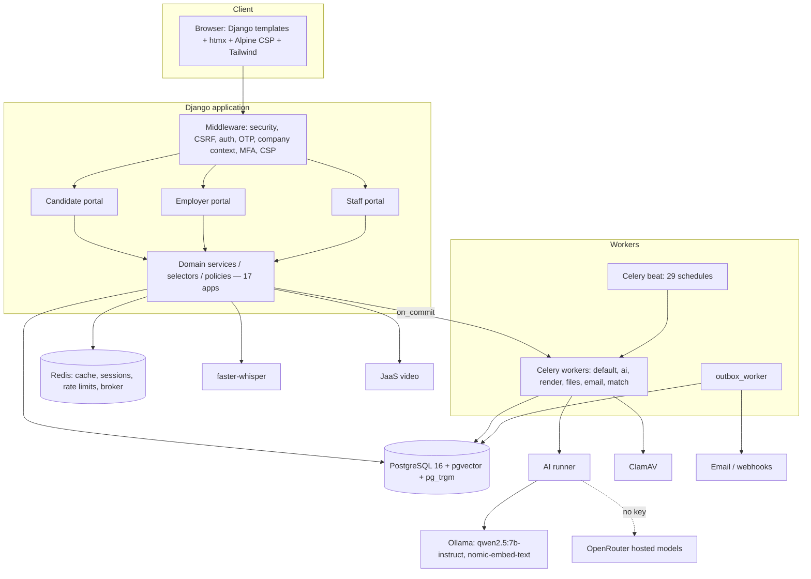

### D02/D03 — Context diagram (DFD Level 0)
**Process:** 0 CareerAI. **External entities and flows:** §8.1 table.
**Nodes:** Candidate, Employer member, Staff, AI provider, Email provider, JaaS,
ClamAV, speech model (drawn inside the boundary if treated as a local component).

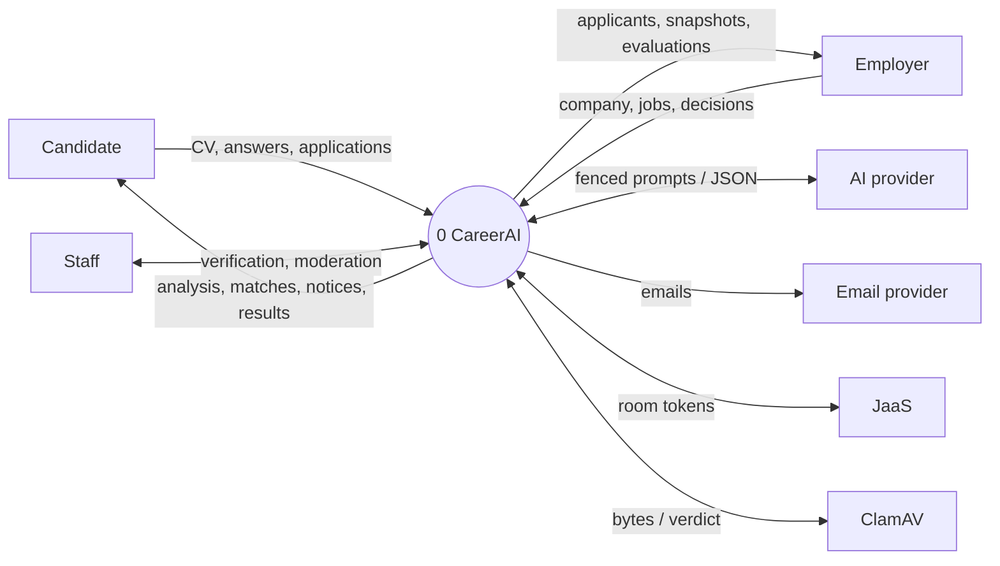

### D04 — DFD Level 1
Processes P1–P14 and stores D1–D14 exactly as §8.2. **Connections** as the §8.2
table. Draw the stores as open rectangles, the processes as circles, and the
external entities from D02 at the edges.

### D05 — DFD Level 2, CV processing
**Nodes:** 2.1 Validate & sniff → 2.2 Store (D3) → 2.3 Scan (↔ ClamAV) → 2.4
Extract → 2.5 Parse → 2.6 Propose (D4) → 4.1 Freeze (D4) → 4.2 ATS checks → 4.3
Score → 4.4 Findings → 4.5 Target coverage (reads D6) → 4.6 Save (D5) → 4.7
Enrich (↔ AI via P13) → 3.1 Plan (reads D5) → 3.2 Job (D4) → 3.3 Draft (↔ AI) →
3.4 Decide (writes D4).
**Decisions:** infected? → stop; picture? → no text; findings addressed? →
status.

### D06 — DFD Level 2, Interview
**Nodes:** 8.1 Plan kit (reads D7, ↔ AI, writes templates) → 8.2 Start (D9) →
8.3 Serve (lock D9) → 8.4 Answer (lock, current check) → 8.5 Transcribe (voice)
→ 8.6 Follow-up (↔ AI) → 8.7 Conclude → 8.8 Evaluate (↔ AI; verify) → 8.9
Outcome (D9) → 8.10 Notify (D11).

### D09 — Candidate activity diagram
**Nodes:** Sign up → Confirm email → Upload CV → (fork) Scan / Parse → Review
proposals → Analyse → decision "improve?" → Guided or Assisted → Accept
suggestions → Browse / Matched jobs → Apply → decision "interview offered?" →
Book / Practice → Attend → Result → end.
**Loops:** improvement loop until the plan is done; job search loop.

### D10 — Employer activity diagram
Create company → Upload documents → Submit verification → [Staff decides] →
Invite team → Post job (skills, questions) → Receive applications → loop
{Review, Move stage, Note/Tag/Rate} → decision "interview?" → Schedule / AI
interview → Score → decision "offer?" → Send offer → decision "accepted?" →
Hired / Not proceeding.

### D20 — Security / authorization flow

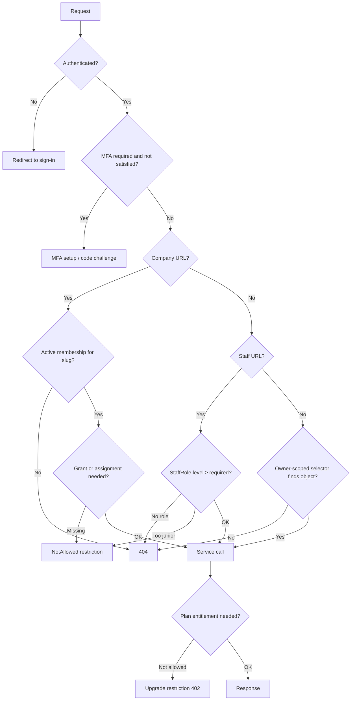

### D21 — Deployment diagram
**Nodes:**
- Reverse proxy (TLS) → Web container (Django + WhiteNoise, `Dockerfile`).
- Worker containers: Celery default/files/render/email/match; a separate ai
  worker; Celery beat; outbox_worker.
- PostgreSQL 16 server; Redis 7; ClamAV daemon.
- Ollama host (optional GPU) or OpenRouter (internet).
- JaaS (internet); SMTP provider (internet).
- Volumes: public media, private files.

**Connections:** web ↔ DB/Redis; workers ↔ DB/Redis; workers → ClamAV/Ollama;
web → JaaS token signing; workers → SMTP.

### D22 — AI architecture

```mermaid
flowchart LR
    F[Feature service] -->|run task_key, inputs| K{Kill switch 'ai' on?}
    K -- off --> X[AIDisabled → feature degrades]
    K -- on --> Q{Quota & max_cost ok?}
    Q -- no --> QE[quota_exceeded]
    Q -- yes --> C{Cache hit? task+prompt_version+input hash}
    C -- yes --> R[Return cached run]
    C -- no --> P[Load PromptTemplate current version; fence inputs]
    P --> CH[chain_for task: capable → cheap → local]
    CH --> D[Dispatch to provider]
    D --> V{Valid JSON schema?}
    V -- no --> SE[schema_error → stop / retry once where configured]
    V -- yes --> OKR[AIRun ok: cost, latency, lineage]
    D -- timeout/provider error --> CH
    OKR --> PV[Feature-level validation: grounding, quote checks, ceilings]
    PV --> OUT[Suggestion / score / text for human decision]
```

### D23 — CV processing pipeline
Use the §17 stage list as a left-to-right pipeline with the state labels
beneath each stage (scan: pending→clean; parse: pending→parsed; enrichment:
pending→ok; suggestion: offered→accepted).

### D24 — Recommendation / matching pipeline
Candidate profile + CandidateSkill → normalise/resolve (ALG-05/06) →
SkillCredit (direct + implied, ALG-07/08) → hard filters → retrieval strategy
(exact / filtered / ANN, ALG-09) → thin-result widening → six-component score
(ALG-10) → band with requirement cap (ALG-11) → ranked feed with breakdown →
`match_snapshot` frozen on application.

---

## 39. Report chapter mapping

| Chapter | Content from this document | Diagrams | Screenshots | Tables |
|---|---|---|---|---|
| 1 Introduction | §1.1–1.2, §2 | D02 | Landing page | Capability table (§1.3) |
| 2 Literature / background | Not established from the current repository (write from external sources; do not invent) | — | — | — |
| 3 Requirement analysis | §2, §6 | D08 | — | Functional objectives, use-case table |
| 4 System analysis & design | §3, §5, §8, §9, §10, §21 | D01, D04–D07, D09–D10, D15–D19 | — | Entity list, state machines |
| 5 Methodology | §3.2 conventions, §16 hybrid, §29 strategy | D22 | — | Hybrid table |
| 6 Implementation | §4, §7, §17, §18, §22–§28 | D11, D13, D14, D20, D21, D23 | Most screens (§40) | Stack, endpoints, background jobs |
| 7 Algorithms & AI | §11–§16 | D12, D22, D24 | Analysis, matched jobs, interview result | Algorithm list, AI inventory, models |
| 8 Database design | §5 | D07 + sub-diagrams | — | Entity attributes, constraints |
| 9 Testing | §0, §29, §30 | — | Test run output, a11y report | Test matrix, counts |
| 10 Results | §31, §0 sweeps | — | Performance screenshots | Performance table |
| 11 Security | §19, §20 | D20 | MFA, security settings, stale interview page | Security mechanisms, permission matrix |
| 12 Limitations | §35 | — | — | Limitations A–F |
| 13 Future enhancements | §36 | — | — | Future work table |
| 14 Conclusion | §43 | — | — | Final status table |

---

## 40. Screenshot / evidence checklist (screens that exist)

| # | Screen | URL | Account |
|---|---|---|---|
| 1 | Landing page | `/` | visitor |
| 2 | Pricing (visitor and signed-in states) | `/pricing/` | visitor, demo.interview |
| 3 | Sign up / sign in / MFA code | `/accounts/signup/`, `/accounts/login/` | — |
| 4 | Candidate dashboard (with demo ad) | `/dashboard/` | demo.candidate |
| 5 | CV upload + progress chip | `/cv/upload/` | demo.newcandidate |
| 6 | Import proposals | `/cv/upload/processing/` | after upload |
| 7 | CV analysis report (+ Improve this CV, demo ad) | `/cv/analysis/` | demo.interview |
| 8 | Template gallery / template detail / Pro lock / compare | `/cv/templates/…` | demo.interview (free) |
| 9 | CV editor with live preview | `/cv/builder/<id>/` | any candidate |
| 10 | Guided improvement ("What we found") | `/cv/builder/<id>/guided/` | candidate with analysis |
| 11 | Assisted CV ("What we are going to change", progress, proposed changes) | `/cv/builder/<id>/describe/` | candidate with analysis |
| 12 | Job list (with sponsored demo ad), job detail, company page with Follow | `/jobs/…` | visitor/candidate |
| 13 | Matched jobs with breakdown | `/jobs/matched/` | demo.candidate |
| 14 | Apply form | `/jobs/<slug>/apply/` | candidate |
| 15 | Applications list/detail | `/applications/` | demo.candidate |
| 16 | Notifications | `/notifications/` | demo.candidate |
| 17 | Messages | `/messages/` | demo.candidate |
| 18 | Interviews hub, practice question, stale-question page, result | `/interviews/…` | demo.interview |
| 19 | Plan & billing (candidate) | `/dashboard/plan/` | demo.interview / demo.candidate |
| 20 | Settings: security (sessions, MFA), privacy, data export | `/settings/…` | any |
| 21 | Employer overview, jobs, job create, applicants, pipeline, team, verification, billing, talent, interviews | `/employer/<slug>/…` | demo.employer |
| 22 | Staff portal: verification queue, companies, people, operations | `/staff/…` | demo.staff |
| 23 | Demo ad "Learn more" page | `/sponsored/example-learning/` | any |
| 24 | Mobile views (375 px) of dashboard, template detail, plan | — | — |
| 25 | Footer (desktop and mobile) | any public page | visitor |

---

## 41. Source-code reference index

| Feature | App | Important files / functions | Models | Templates | Tests |
|---|---|---|---|---|---|
| Sign-up, verification, reset | accounts | `views.py`, `services/identity.py` | User, EmailAddress, ConsumedToken | `templates/accounts/*` | `apps/accounts/tests` |
| MFA | accounts | `mfa_policy.py`, `middleware.py` | django-otp devices | settings/security | accounts tests |
| Staff levels | accounts | `staff.py` | StaffRole | `templates/staff/*` | `portals/staff/tests` |
| Upload & scanning | files, resumes | `files/services.py`, `sniff.py`, `scanning.py`; `resumes/services/upload.py` | Attachment, ResumeUpload | `resume/upload.html` | files/resumes tests |
| Parsing | resumes | `parsing/extract.py::parse`, `text.py` | ResumeParse | — | `test_parsing.py`, `test_extraction_benchmark.py` |
| Analysis | resumes | `services/analysis.py`, `analysis/{checks,scoring,findings,target}.py`, `readiness.py` | ResumeAnalysis, ResumeFinding, ResumeAtsCheck | `resume/analysis.html`, `_analysis_report.html` | `test_analysis*.py`, `test_readiness*.py` |
| Improvement plan & jobs | resumes | `improvement.py`, `services/improvements.py`, `tasks.py::run_improvement_job` | ImprovementJob | `resume/_improvement_*.html`, `guided.html`, `assistant.html` | `test_improvement.py`, `portals/candidate/tests/test_cv_improvement_screens.py` |
| Assistant | resumes | `services/assistant.py`, `evidence.py` | BuilderSession, ResumeSuggestion | `_transcript.html` | `test_assistant.py`, `test_evidence.py` |
| Templates & rendering | resumes | `seeds.py`, `rendering/{theme,layout,pdf,docx}.py`, `presentation.py`, `examples.py` | ResumeTemplate, ResumeRender | `resume/templates.html`, `template_detail.html`, `_paper.html` | `test_rendering.py`, `test_template_experience.py` |
| Taxonomy | taxonomy | `services/skills.py`, `normalisation.py`, `services/terms.py` | Skill, SkillAlias, SkillRelation | admin | `apps/taxonomy/tests` |
| Matching | matching | `retrieval.py`, `scoring.py`, `extract.py`, `services/recommendations.py`, `snapshots.py` | vectors on Job/Profile | `jobs/matched.html` | `apps/matching/tests` |
| Jobs | jobs | `services/postings.py`, `events.py` | Job, JobSkill | `templates/jobs/*`, employer job templates | `apps/jobs/tests` |
| Applications | applications | `services/apply.py`, `pipeline.py`, `review.py`, `offers.py`, `letters.py` | Application, PipelineStage, Offer | applications, employer applicants | `apps/applications/tests` |
| Companies & team | companies | `services/company.py`, `membership.py`, `follows.py`, `permissions.py`, `middleware.py` | Company, CompanyMembership, CompanyVerification | `templates/employer/*` | `apps/companies/tests` |
| Interviews | interviews | `services/engine.py`, `planning.py`, `relevance.py`, `evaluation.py`, `delivery.py`, `speech/`, `providers/jitsi.py` | InterviewSession, InterviewTurn, InterviewEvaluation, InterviewOutcome | `templates/interviews/*` incl. `stale.html` | `apps/interviews/tests` incl. `test_question_replay.py` |
| Notifications | notifications | `events.py`, `services/audiences.py`, `consumers.py`, `tasks.py`, `management/commands/outbox_worker.py` | OutboxEvent, Notification, NotificationDelivery | `templates/notifications/*` | `apps/notifications/tests` |
| Billing | billing | `services/{entitlements,subscriptions,invoices,plans}.py`, `tasks.py` | Plan, Subscription, Invoice, Payment | `dashboard/plan.html`, `pages/pricing.html`, employer billing | `apps/billing/tests` |
| AI | ai | `services/{runner,prompts,schema,quotas,evals}.py`, `providers/*` | PromptTemplate, AIRun, AIUsageQuota | — | `apps/ai/tests` |
| Rate limits, errors, fragments, CSP | common | `ratelimit.py`, `errors.py`, `errors_middleware.py`, `restrictions.py`, `fragments.py`, `csp.py`, `idempotency.py` | ConsumedToken | `restriction.html` | `apps/common/tests` |
| Footer & demo ads | core | `navigation.py::FOOTER_NAV`, `ads.py`, `templatetags/demo_ads.py`, `views.py::DemoAdView` | — | `partials/footer.html`, `components/demo_ad.html`, `pages/demo_ad.html` | `apps/core/tests/test_footer_and_ads.py` |
| Feature flags | core | `features.py` | FeatureFlag | — | `test_features.py` |
| Settings & AI config | config | `settings/{base,dev,prod,test}.py`, `ai.py`, `celery.py` | — | — | — |

---

## 42. Glossary

| Term | Meaning in CareerAI |
|---|---|
| Candidate | A user with a `CandidateProfile`; seeks jobs |
| Company | Employer organisation (`Company`), addressed by slug |
| CompanyMembership | A user's role in a company; the authorization spine |
| Owner / Admin / Recruiter / Hiring manager / Interviewer / Viewer | Company roles (§20) |
| Grant | A named company capability, e.g. `job.publish` |
| Staff | Platform operator with a `StaffRole` level (support → superadmin) |
| CV / ResumeDocument | A candidate's CV; edited as a draft, frozen as versions |
| Draft / Version | Editable working copy / immutable snapshot used by analyses, exports, applications |
| Suggestion | A proposed CV change (`ResumeSuggestion`) that a person accepts or rejects |
| Finding | One observation from an analysis (`ResumeFinding`), with severity and section reference |
| Improvement plan | Findings carried into guided/assisted improvement (`improvement.plan_for`) |
| ImprovementJob | Background improvement work with persisted stages |
| Skill / Taxonomy | Canonical skills with aliases, relations and translations |
| SkillCredit | A candidate's direct and implied skill coverage used in matching |
| Match / Band | 0–100 weighted score and its label (strong/good/partial/stretch) |
| Readiness | The single "is this CV complete for its aim" verdict |
| Interview session / Turn | One interview / one question and its answer |
| Stale question | A submission for a question that is no longer current — refused without writing |
| AI evaluator | `interview.evaluate` task bounded by deterministic checks |
| AIRun | Record of every model attempt |
| Outbox event | Transactional event row delivered after commit |
| Audience | Named recipient resolver for a notification event |
| Entitlement | A plan limit checked server-side |
| Demo ad | A labelled, fictional sponsored block used only to demonstrate the slot |

---

## 43. Final project status

| Area | Status | Evidence | Remaining requirement |
|---|---|---|---|
| Core platform (accounts, portals, errors, flags) | IMPLEMENTED, verified | tests; sweeps | — |
| CV system (upload → analysis → improvement → export) | IMPLEMENTED, verified | tests; browser flows 2026-09-27 | OCR deferred |
| Matching | IMPLEMENTED, verified | matching tests | Match explanations not surfaced |
| AI | IMPLEMENTED with local model | AIRun records; tests with FakeAdapter; browser runs with qwen2.5:7b | Hosted models need a key; local model slow/lenient |
| Interviews | IMPLEMENTED, verified; replay protection verified | `test_question_replay.py`; built-in browser Back test | Live video (JaaS) EXTERNAL; real-microphone test manual |
| Security | IMPLEMENTED, verified | §19; IDOR 0 leaks; hostile forms 0 failures | Production TLS/headers verified only by settings |
| Employer portal | IMPLEMENTED, verified | tests; sweeps | — |
| Staff portal | IMPLEMENTED, verified | tests | — |
| Notifications | IMPLEMENTED, verified | tests | Real email provider EXTERNAL |
| Billing | IMPLEMENTED, verified; eSewa sandbox verified live (hand-off, cancel, status API) | `test_gateways.py` (60+ tests); §44 | A sandbox payment completed by a person with eSewa's test wallet; Khalti merchant sandbox key; live merchant accounts |
| Demo ads | IMPLEMENTED, verified | `test_footer_and_ads.py`; browser | Demo only by design |
| Footer | IMPLEMENTED, verified | tests; screenshots 1280/768/375 | — |
| Testing | **4,198 tests, 0 failures, 0 errors** (2026-10-01) | §0 | Human manual test plan to execute |
| Static checks | App code clean; mypy clean | §0 | Delete `fix_tables.py` to make repo-wide ruff clean |
| Deployment | Configured, not deployed | settings, Dockerfile, docs | Production environment, backups, monitoring |
| External integrations | ClamAV, SMTP, JaaS, OpenRouter configurable | settings | Accounts/keys and live verification |

---

## 44. Refinement round (2026-10-01)

Implementation work from the "comprehensive product refinement" request. Each item
links to where the detail lives.

### 44.1 CV upload validation
- `apps/resumes/services/validation.py` runs on the request **before anything
  is stored**:
  - size;
  - extension (.pdf, .doc or .docx);
  - content signature (`files.sniff.classify`);
  - structure:
    - DOCX: main part content type, no `vbaProject.bin`, no DOCTYPE or
      entities, zip-bomb limits, opens in python-docx;
    - DOC: OLE2 `WordDocument` stream, not encrypted, no macro storage;
    - PDF: opens, not password-protected, 1–100 pages;
  - for signed-in uploads, content: a text layer, and recognised CV sections
    or dated roles with contact details.
- Every refusal reads "Upload your CV or resume in PDF, DOC, or DOCX format."
  followed by the specific reason. A refused file leaves no attachment, upload
  row, stored file, scan or parse job.
- Guest uploads are checked for structure only. ADR-A32 forbids reading their
  content before claim.
- Word 97-2003 `.doc` is now supported, by a pure-Python reader with no new
  dependency. Fixtures come from Microsoft Word.
- Benchmark corpus: 30 of 30 real CVs accepted in both PDF and DOCX; only the
  deliberate scan and near-empty cases are refused.
- Tests: `apps/resumes/tests/test_upload_validation.py` (58).

### 44.2 CV analysis performance
`docs/benchmarks/CV-Analysis-Timing.md` has the stage-by-stage measurements.
- **Bottleneck:** the LLM review, 46–102 s on a CPU-only `qwen2.5:7b`, against
  under 1.2 s for every other stage.
- **Changes:**
  - the parse reuses the validation's text and page count (316–773 ms down to
    20–59 ms);
  - Ollama `num_ctx=8192`. It was silently truncating long CVs at 4,096 tokens;
  - the review timeout is 300 s (background) and the output cap 1,200;
  - the prompt states the six-finding limit.
- **Result:** medium and large DOCX reviews now complete; before, they timed
  out at 120 s.
- **Remaining:** a synthetic, highly repetitive four-page PDF still makes the
  model loop (`schema_error`). The deterministic report is unaffected and the
  retry is free.
- **Progress:** the processing page tells "waiting to be read" apart from
  "reading it" and shows failures with their reason. The pending-review text no
  longer implies a human reviewer.

### 44.3 Footer
- The "For employers" column now has:
  - Hiring with us
  - Employer portal
  - Post a job
  - Manage jobs
  - Applicants
  - Company profile
  - Create a company account
- Company-scoped pages are reached through `employer:go`, which resolves the
  member's own company, offers registration if there is none, and offers the
  chooser if there are several.
- `go` is a reserved company slug.
- Tests: `FooterEmployerLinkTests`.

### 44.4 Payments (ADR-A58)
- eSewa ePay v2 and Khalti KPG-2 adapters behind `apps/billing/gateways`.
  `PaymentAttempt` model; checkout service; views under `/billing/`; admin
  with the payment environment and gateway configuration state (never
  credentials).
- **Test mode only:**
  - `billing.E001`: a non-test environment is refused;
  - `billing.E002`: an enabled gateway without its credentials is refused;
  - `billing.E003`: a live host is refused in test mode.
- Verified against the live eSewa sandbox:
  - our signed form is accepted (302 to eSewa's login, showing EPAYTEST and
    NPR 100.00), and a forged signature is refused with `ES104`;
  - the cancel path returns, eSewa's status API answers `NOT_FOUND`, and the
    attempt is recorded as cancelled;
  - the status-response shape matches the parser.
- A completed sandbox payment needs eSewa's test login, which includes a
  reCAPTCHA. A person must do it with eSewa's published test wallet.
- Khalti needs a per-merchant sandbox key from test-admin.khalti.com. Fonepay
  has no public sandbox.
- Tests: `apps/billing/tests/test_gateways.py` covers success, cancel,
  failure, invalid signature, wrong amount, wrong UUID, unknown reference,
  replay, duplicate, concurrent verification, delayed confirmation, status
  API failure, unreachable gateway, refund, double payment, past-due
  reactivation, access control, admin and configuration checks.

### 44.5 Branding
- `SITE_NAME`, `SITE_TAGLINE` and `SITE_SUPPORT_EMAIL` come from the
  environment. Templates, emails, PDF metadata and "Apply on …" labels read
  them.
- The new name was given only as `[NEW WEBSITE NAME]`, so CareerAI stays as
  the working title (`docs/BRANDING.md`).
- CV features carry no "AI" in their names. Model-written text stays labelled.

### 44.6 Sample CV content
- The worked example no longer credits invented achievements to a real
  company (Fonepay). Its employers are fictional.
- The unverifiable claim "used by two Nepali fintechs; 600 stars" was removed.
- Date ranges use en dashes. Improvement questions were reworded without em
  dashes.
- Sample isolation tests are unchanged and pass.

### 44.7 Django admin
- All 124 models are covered: 119 registered, 3 as inlines and 2 excluded on
  purpose by decision D-01 (message text and verification documents)
  (`docs/ADMIN.md`).
- `apps.common.admin_tools.RecordAdmin` makes records view-only, keeps private
  content out of every page, and names content-bearing models by id.
- Security fix: django-otp's admin showed TOTP secrets, QR codes and backup
  tokens. `OTP_ADMIN_HIDE_SENSITIVE_DATA = True`, and the devices are
  view-only.
- Tests: `apps/core/tests/test_admin_inventory.py`.


---

## 45. Product refinement and acceptance round: Kaarya (2026-10-02)

Requirement-by-requirement status and evidence:
`docs/requirements/Kaarya-Refinement-Tracker.md`. Supersedes §44.5 on
branding.

### 45.1 Branding
- Public name **Kaarya**, tagline "CV, Jobs → Opportunities", from
  `SITE_NAME`/`SITE_TAGLINE` (defaults changed; internal identifiers kept).
- The supplied logo's mark is used unaltered (extracted from the artwork onto
  a transparent background). The artwork spells "KARYA", so the wordmark is
  live text from `site.name` (`docs/BRANDING.md`).
- "Apply on …" choice labels are brand-free ("Apply directly"), so a rename
  needs no migration.
- Still external: the support domain and the legal-text contact address.

### 45.2 Copy and CV examples
- About 120 template and 63 Python strings rewritten by hand: fewer em dashes,
  plainer sentences. Meaning unchanged; tests that pinned old wording were
  updated to the new wording.
- Six fictional personas (`apps/resumes/example_personas.py`), one per
  template family: no real employers, `example.com` contacts.

### 45.3 Allowances and checkout (ADR-A59)
- Per-feature allowances on the existing claim/release machinery: assisted CV
  replies (day), CV improvement drafts (day), practice interviews (month),
  cover letter drafts (month), CV analyses (month). Free 20/5/2/2/1, Pro
  300/100/40/50/unlimited.
- Refusals are a normal state: "You've reached your plan's limit", the counts,
  the reset date and the upgrade route. Failures refund.
- Paid access starts only on a verified payment (`activate_paid` inside
  `payments._record`). Pro is NPR 1,700 a month everywhere, formatted by
  `format_money`. Pricing cards list every allowance from the plan rows.
- Reference: `docs/billing/Pricing-and-Quotas.md`.

### 45.4 CV lifecycle
- Saved CVs (`saved_at`), unsaved drafts (limit 5, removed after 14 untouched
  days by a beat task) and archived CVs are listed separately. Deleting asks
  first; a never-saved CV is removed outright and its URLs stop working.
- Reference: `docs/CV-Lifecycle.md`.

### 45.5 Assisted CV
- The primary way to build a CV: one prompt with examples, opt-in reuse of the
  candidate's upload, a background conversation, review, save.
- Live journeys found and fixed two defects: the reuse box was pre-ticked, and
  the assistant asked for a number again after the candidate said they did not
  remember it.
- Reference: `docs/Assisted-CV.md`.

### 45.6 Job verification filter
- All / verified / not yet verified, read only from
  `Company.verification_state`, combined with every other filter, kept across
  pages and saved searches; facet counts exclude their own choice.
- Reference: `docs/Job-Search.md`.

### 45.7 Performance (end to end, real worker)
- Queues are not a bottleneck: tasks picked up in 105–290 ms. The parse is
  8 ms of work; the outbox hop adds 0–2 s by design.
- The progress screens polled every 5 s, so a CV parsed at 1.9 s was shown at
  5.8 s. Now every 2 s: shown at 2.8 s.
- The model review is 59–83 s on this CPU and is the remaining wait.
- Reference: `docs/benchmarks/CV-Analysis-Timing.md`.

### 45.8 Defects found by this round's sweeps and fixed
- `/cv/builder/describe/?new=1` returned 500 for a signed-in user without a
  candidate profile (link sweep, 5 employer personas).
- Five data tables (plan invoices, employer billing, three staff screens) had
  no cell styling: `table` was only Tailwind's display utility.
- The plan page's big number was "used" while its caption counted "left".
- The overview hid a candidate's saved CVs until their profile had content,
  which is exactly the Assisted CV user.
- A main CV that was still an unsaved draft had no "Main CV" label, and its
  expiry could leave the candidate without a main CV.
- Draft expiry dates crashed the overview for a document without a draft row.
- Contrast: the jobs list "Verified" label, filter chip labels, the sort
  select's name at phone widths, and hidden CV sections dimmed with opacity
  (their own "Show" button fell to 2.8:1).
- `ResumeParse.duration_ms` recorded 0 ms (timer resolution).

### 45.9 Journeys (real browser, real worker)
| Journey | Result |
|---|---|
| A. Sign-up, upload, analysis, matched jobs, drafts | Pass |
| B. Assisted CV from an example to a saved CV | Pass (two defects fixed) |
| C. Free limits on practice interviews | Pass |
| D. Upgrade to Pro through eSewa | Pass to the provider page; the payment itself needs a person (reCAPTCHA) |
| E. Verified and unverified employers, candidate filter at 375 px | Pass |
| F. Staff and security | Pass: 6 personas × 13 URLs as expected; support cannot suspend, moderator can; a superadmin cannot approve their own role proposal; staff accounts cannot be impersonated; admin hides TOTP secrets and password hashes; support sees no CV text |
